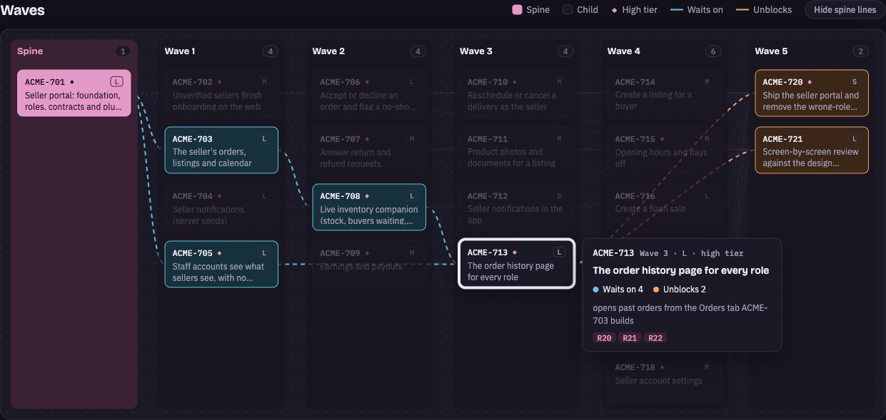

# Portia

[](https://github.com/mousedown/portia/actions/workflows/ci.yml)
[](LICENSE)

**Hand Claude Code an epic, get back one reviewed pull request.**

**Plan → spine → waves → epic PR → you merge.**

Portia is a Claude Code skill plus a small CLI. Point it at an epic (or a large story) in Jira or GitHub Issues and it plans the work, writes the acceptance tests first, then fans the tickets out to parallel workers, each in its own git worktree, driven by one `portia drive` command that stops only where a person or the AI is needed. Every piece is gated and merged onto one integration branch, and you get a single PR to review at the end. Portia never merges to `main`.

```text
/portia PROJ-123
```

Named for the judge in *The Merchant of Venice*, who hears the evidence before anything is decided. Every piece of a run proves itself before it lands, and the verdict on the whole is yours.

## Is it the right tool?

- **Good fit:** a feature with some shared groundwork and several tickets that can be built side by side.
- **Not a fit:** a single small change (Portia will decline it at planning time), or a batch of unrelated tickets (they'd all ship as one PR).

## Get started

**1. Install.** On macOS, Linux or WSL:

```sh
curl -fsSL https://raw.githubusercontent.com/mousedown/portia/main/scripts/install.sh | bash
```

That takes under a minute. It installs [Bun](https://bun.sh) if you don't have it, then the latest release of the `portia` CLI and the `/portia` and `/portia-setup` skills, all under your home directory and without `sudo`. [Read the script](scripts/install.sh) first if you like.

To run an epic you also need [Claude Code](https://docs.claude.com/claude-code) and the [GitHub CLI](https://cli.github.com), logged in with `gh auth login`. The installer tells you if either is missing. For a Jira tracker, set `JIRA_BASE_URL`, `JIRA_EMAIL` and `JIRA_API_TOKEN`.

<details>
<summary>Other ways to install</summary>

With Bun, and the skills from the Claude Code plugin marketplace. Plugin skills are namespaced: `/portia:portia` and `/portia:portia-setup`.

```sh
bun add -g @mousedown/portia
```

```text
/plugin install portia --marketplace mousedown/portia
```

Use one route or the other, not both. Update this route with `bun add -g @mousedown/portia@latest` and `/plugin update portia`.

</details>

**2. Set up your repository.** In Claude Code, from the repo:

```text
/portia-setup
```

or in a terminal:

```sh
portia init
```

Either one detects your tracker, checks and machine, shows them, and asks whether you want to change anything. Press Enter to accept a default.

```text
◆  Detected settings
│  Tracker        GitHub Issues (acme/widget)
│  Checks         bun run lint, bun run typecheck, bun run test
│  Workers        4 at once
│  Models         opus for hard tickets, sonnet for routine ones
│  Branch prefix  epic/<KEY>
│  Save to        ~/.portia/profiles/widget.ts
│
◆  Want to modify these settings?
│  ○ Yes / ● No
```

**3. Run an epic** (next section).

Update by running the installer again. It takes `--uninstall` to remove Portia, `--ref <tag>` to install a particular version, and `--design` to add Chromium for design checks (`bunx playwright install chromium` does the same for the Bun route).

## Run it

Open Claude Code in the root of the repository and ask:

```text
/portia PROJ-123        # a Jira epic or story
/portia GH-42           # a GitHub issue
portia resume PROJ-123  # pick up a run that was interrupted
```

What happens next:

1. **Plan.** Portia reads the epic and its tickets and shows you a wave table: which tickets run together and which wait for others. Nothing is written until you say yes. The plan is stored in the tickets themselves.
2. **Spine.** One worker lands the shared code (schema, types, API shapes) and writes every acceptance scenario as a failing test. You sign off that the tests describe the feature.
3. **Waves.** Ready tickets run in parallel, each in its own worktree with its own port and database. Each one is rebased, re-gated, PR'd into the integration branch and squash-merged once CI passes.
4. **Epic PR.** When every ticket has landed and the acceptance tests pass, the epic PR is marked ready. **You review and merge it.**

<picture>
  <source media="(prefers-color-scheme: light)" srcset="docs/images/run-light.png">
  
</picture>

### See the whole plan first

Before any worker starts, Portia publishes the plan as a private Claude page you can share. It has a map of every wave, with each child linked to the children it waits on. Hover a child to see what it waits on, what it unblocks and why. Under the map, wave tabs list each child's dependencies and the acceptance scenarios it delivers, each one a line you can expand into Given, When and Then. `portia view` links to the page from the run.

<picture>
  <source media="(prefers-color-scheme: light)" srcset="docs/images/plan-light.png">
  
</picture>

### Judgement, not guesswork

Portia stops and asks you, instead of guessing, when:

- the plan needs your approval
- the acceptance tests need sign-off
- a worker parks with a question
- `main` conflicts with the integration branch
- a spend cap is reached

<picture>
  <source media="(prefers-color-scheme: light)" srcset="docs/images/child-parked-light.png">
  
</picture>

### What it proves

- **Before a child merges**, its gates run again on the head rebased onto the integration branch, not on the branch the worker left.
- **Nothing breaks what landed.** The ratchet re-runs every scenario that earlier children made pass, so a later child cannot quietly undo one.
- **The epic PR is ready** only when every acceptance spec written at the spine passes.

`portia view PROJ-123 PROJ-130` shows that record for one child: its evidence, gates, files and attempts.

### Watch it

```sh
portia view                  # every run, live
portia view PROJ-123         # one run: its children by wave, or the gate matrix
portia view PROJ-123 PROJ-130  # one child: evidence, gates, files, worker, attempts
```

<picture>
  <source media="(prefers-color-scheme: light)" srcset="docs/images/home-light.png">
  
</picture>

A terminal view of every run: what is running, what waits on you, and what landed, with the machine's CPU, load, memory, disk and worker slots in the header (Portia usually runs on a machine of its own, opened over SSH). It never writes to a run; `n` starts or resumes one by opening `claude "/portia KEY"` in a new tmux or Ghostty window, or copying that command when it can open neither. It is one stack of pages, Home › Run › Child › Worker, with Activity and Machine beside Home; the header shows where you are and the footer the keys that work there, each with its word. Piped, it prints plain tables. See [`portia view`](docs/reference.md#watching-runs-portia-view).

<picture>
  <source media="(prefers-color-scheme: light)" srcset="docs/images/worker-light.png">
  
</picture>

| Key | Does |
| --- | --- |
| `↑` `↓` | Move, or scroll |
| `→` | Open: a run, a child, a child's worker |
| `⏎` | Open; on a child, expand the evidence, gate failure or attempt under the cursor; on Activity, unfold the row |
| `←` `esc` | Back to the page you came from |
| `a` `m` | Activity, Machine (beside Home) |
| `g` | Run: children list or gate matrix |
| `w` | Child: the detached worker's live log |
| `o` | Open the PR of what is selected |
| `n` | Start a run, or resume one that waits: `:new KEY` |
| `y` `e` | Copy the key, or on a child the worktree path; open the worktree in `$EDITOR` |
| `/` `:` `?` `q` | Filter or search, command, help, quit |

## Questions

**Does it merge to `main`?** No. Children squash-merge onto the integration branch (`epic/<KEY>` by default). The epic PR into `main` is yours to review and merge.

**Who decides the waves?** The skill drafts the plan, `portia check` rejects one where two children in a wave touch the same file or the spine does not own the acceptance specs, and you approve the wave table before anything is written. The plan then lives as a block on each ticket.

**What does a run cost?** Tokens, capped. `spend: { worker, wave, epic }` in the profile sets the caps, `dispatch` refuses past any of them, and the run stops to ask you.

**How is it different from Claude Code subagents?** Subagents run tasks. Portia adds what goes around them: a spine that lands the shared contracts and failing acceptance tests first, an isolated worktree, port and database per worker, gates run again after every rebase, and one PR at the end.

**Where does it run?** On your machine, or better, a machine of its own that you open over SSH and watch with `portia view`.

## Learn more

- **[portia.run](https://portia.run)**: the site.
- **[Reference](docs/reference.md)**: how a run works, every profile field, the plan block format, the CLI, gates, safety rules and development.
- **[Full example profile](examples/profile.example.ts)**: every option, including a database, Docker services and design checks.

## Security

Please report a vulnerability privately, not in a public issue: see [SECURITY.md](SECURITY.md).

Portia's rules keep a run honest, but they are not a sandbox. Workers are Claude Code sessions that read your tickets, run commands and inherit your environment's tokens, so only run epics from a tracker whose writers you trust, ideally on a machine of its own. [What these rules do not protect against](docs/reference.md#what-these-rules-do-not-protect-against) has the detail.

## License

[Apache License 2.0](LICENSE). Contributions welcome: see [CONTRIBUTING.md](CONTRIBUTING.md).
