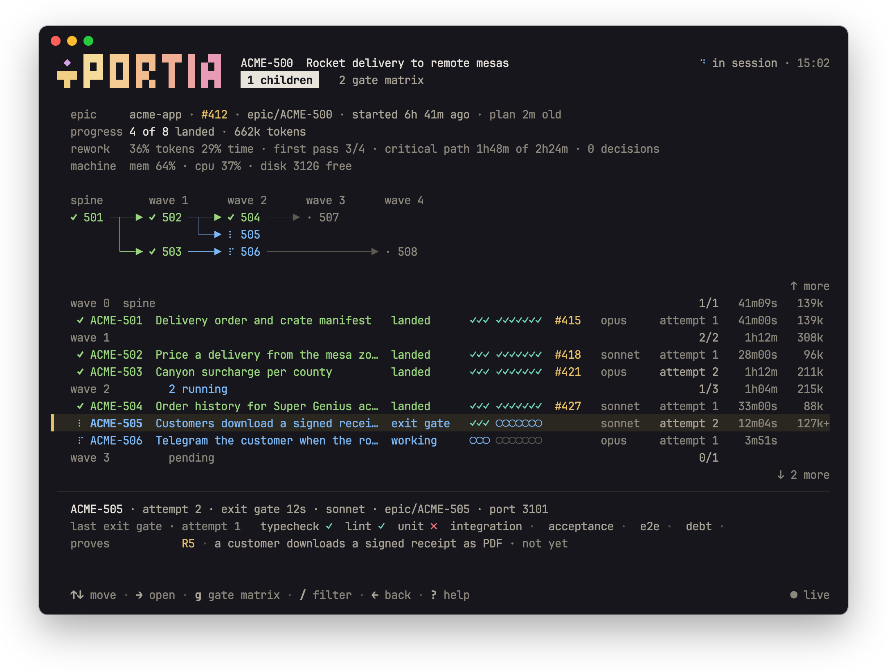
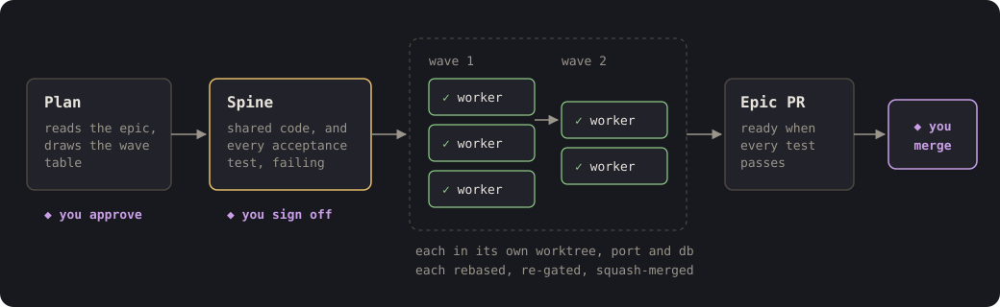
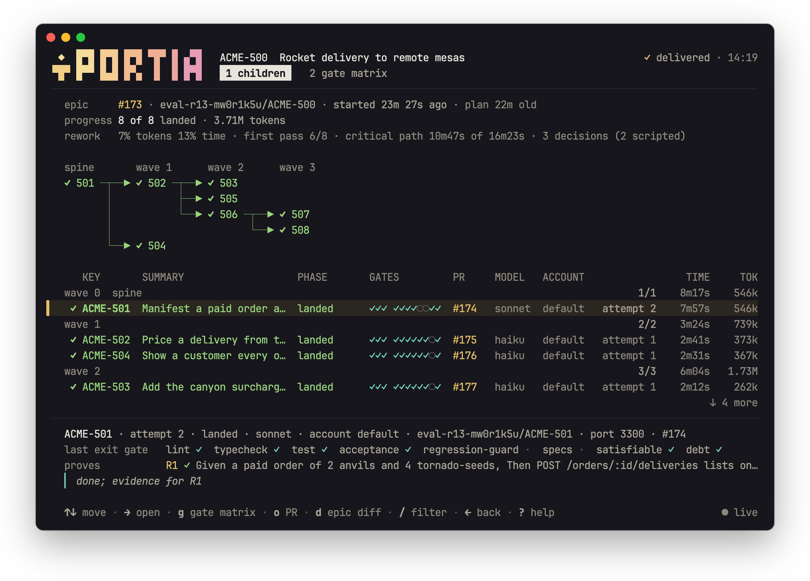
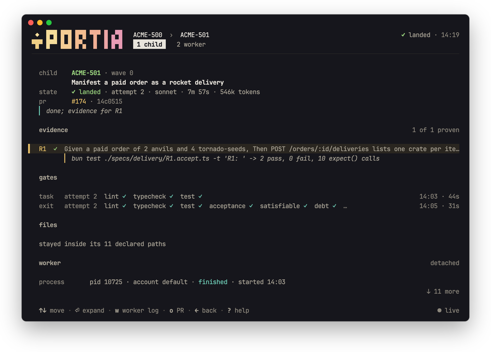
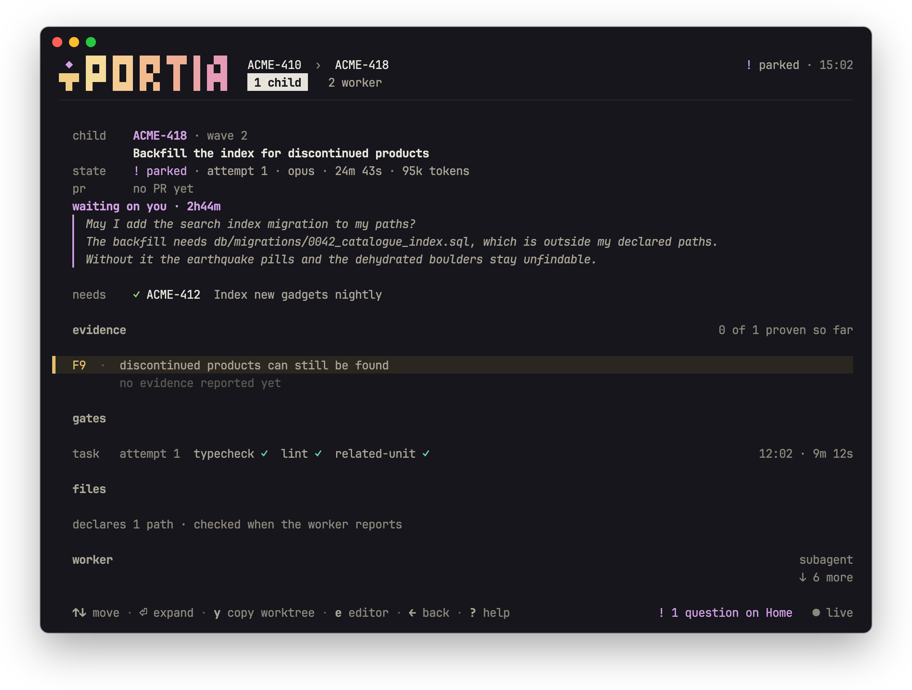
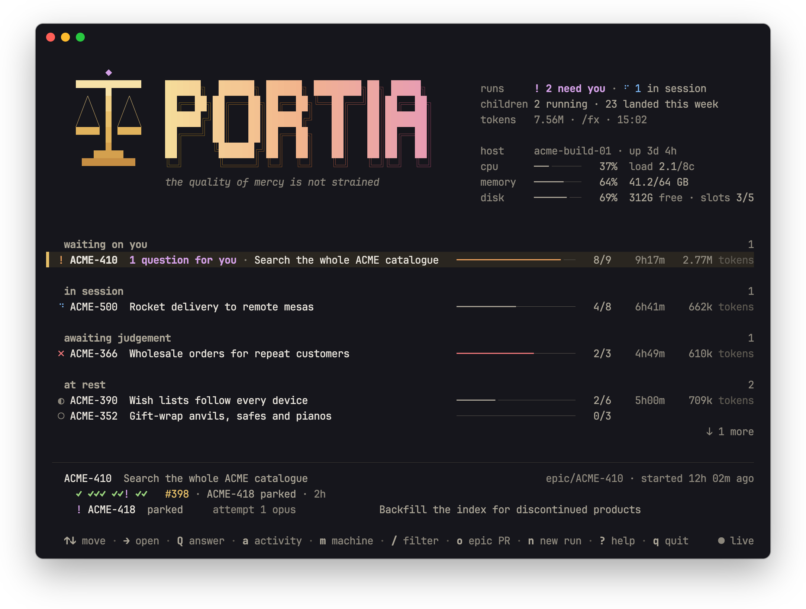
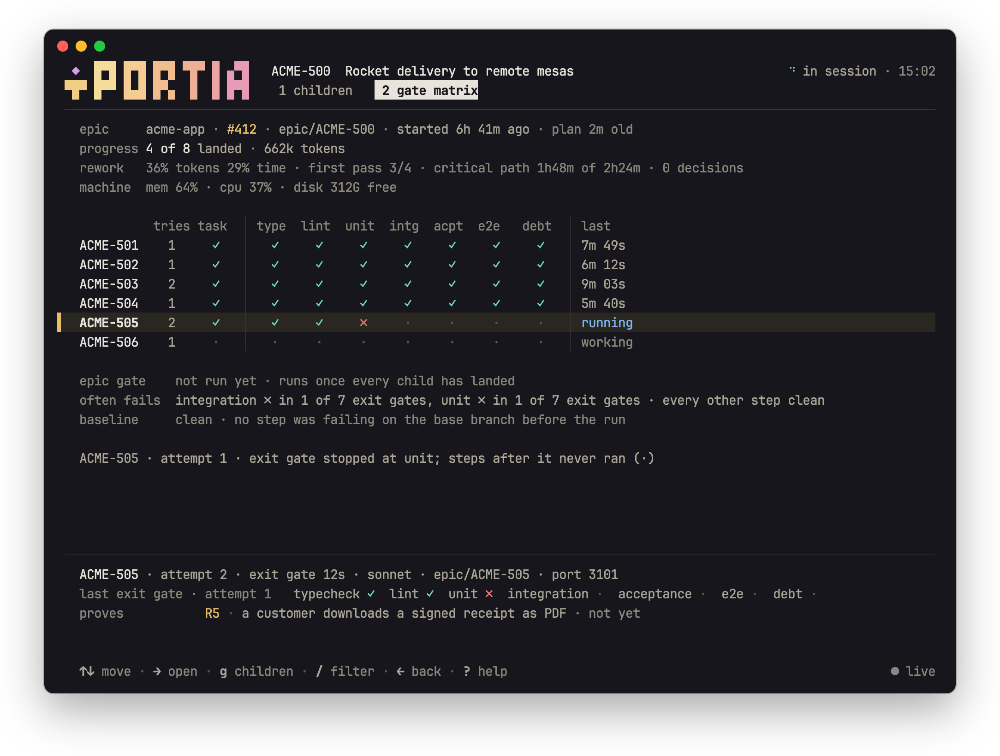
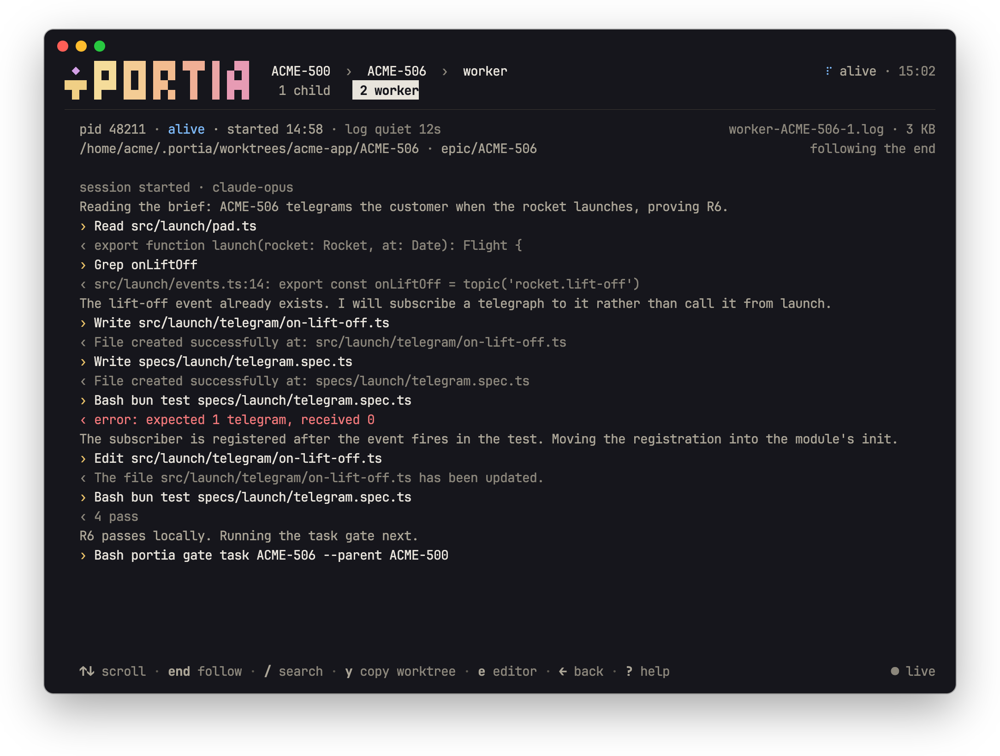

<div align="center">

# Portia

**Hand Claude Code an epic, get back one reviewed pull request.**

[](https://github.com/mousedown/portia/actions/workflows/ci.yml)
[](LICENSE)

[Install](#install) · [How it works](#how-it-works) · [Watch a run](#watch-a-run) · [Reference](docs/reference.md) · [portia.run](https://portia.run)

</div>

<picture>
  <source media="(prefers-color-scheme: light)" srcset="docs/images/run-light.png">
  
</picture>

<sub>Screens are drawn by Portia's own renderer. The epics are invented test data, except [the real run](#what-it-proves) further down.</sub>

Portia is a Claude Code skill plus a small CLI. Point it at an epic or a large story in Jira or GitHub Issues:

```text
/portia PROJ-123
```

It plans the work, writes the acceptance tests first, then fans the tickets out to parallel workers, each in its own git worktree. Every piece is gated and merged onto one integration branch, and you get a single PR to review at the end. **Portia never merges to `main`.**

Named for the judge in *The Merchant of Venice*, who hears the evidence before anything is decided.

| Good fit | Not a fit |
| --- | --- |
| A feature with some shared groundwork and several tickets that can be built side by side | A single small change (Portia declines it at planning time), or a batch of unrelated tickets (they would all ship as one PR) |

## Install

Portia runs on macOS, Linux and WSL. You need [Claude Code](https://docs.claude.com/claude-code) and the [GitHub CLI](https://cli.github.com), logged in. The installer tells you if either is missing, and adds everything else. Installing takes about a minute.

```sh
# 1. Install
curl -fsSL https://raw.githubusercontent.com/mousedown/portia/main/scripts/install.sh | bash

# 2. In a new terminal, from your repository: the setup wizard detects your settings, press Enter to accept
portia init
```

```text
# 3. In Claude Code, from your repository: run an epic
/portia PROJ-123
```

That is all most people need. The steps below say the same thing with more detail.

### 1. Check what you need

| You need | Why | Check it |
| --- | --- | --- |
| [Claude Code](https://docs.claude.com/claude-code) | Runs the skill and the workers | `claude --version` |
| [GitHub CLI](https://cli.github.com), logged in | Opens and merges PRs, reads GitHub Issues | `gh auth status` |
| git | Worktrees, rebases, branches | `git --version` |
| [Bun](https://bun.sh) 1.2 or later | Runs the CLI | The installer adds it if it is missing |

Your project may need more: Jira credentials ([step 4](#4-set-up-your-repository)), Postgres client tools if your profile sets `db`, Docker if it defines `services`, and Chromium for design checks.

### 2. Run the installer

```sh
curl -fsSL https://raw.githubusercontent.com/mousedown/portia/main/scripts/install.sh | bash
```

Everything goes under your home directory, with no `sudo`, and no dependency's install script runs. [Read the script](scripts/install.sh) first if you like.

| Installed | Where |
| --- | --- |
| Portia's source | `~/.portia/src` |
| The `portia` command | `~/.bun/bin/portia` |
| The `/portia` and `/portia-setup` skills | `~/.claude/skills/` (or `$CLAUDE_CONFIG_DIR/skills/`) |

### 3. Check it worked

Open a new terminal and run:

```sh
portia version
```

Then start a new Claude Code session and type `/portia-setup`: the skill should be offered. If either fails, see [Troubleshooting](#troubleshooting).

### 4. Set up your repository

The setup wizard writes a profile for your repository. From its root, in a terminal:

```sh
portia init
```

Or run `/portia-setup` in Claude Code. Either one detects your checks and machine, asks whether your tickets live in GitHub Issues or Jira, shows the result, and asks whether to change anything. Press Enter to accept a suggestion, or Tab to edit it.

```text
◆  Where do your tickets live?
│  ● GitHub Issues (origin is acme/widget) / ○ Jira
│
◆  Settings
│  Tracker        GitHub Issues (acme/widget)
│  Checks         bun run lint, bun run typecheck, bun run test
│  Landing        each ticket's PR waits for CI
│  Workers        4 at once
│  Models         opus for hard tickets, sonnet for routine ones
│  Branch prefix  epic/<KEY>
│  Save to        ~/.portia/profiles/widget.ts
│
◆  Want to modify these settings?
│  ○ Yes / ● No
```

For Jira, set these first, then pick Jira when asked:

```sh
export JIRA_BASE_URL=https://your-team.atlassian.net
export JIRA_EMAIL=you@example.com
export JIRA_API_TOKEN=...
```

### 5. Run an epic

Open Claude Code in the root of your repository:

```text
/portia PROJ-123        # a Jira epic or story
/portia GH-42           # a GitHub issue
portia resume PROJ-123  # pick up a run that was interrupted
```

### Update or remove

Run the installer again to update. Add a flag after `bash -s --` for anything else:

```sh
curl -fsSL https://raw.githubusercontent.com/mousedown/portia/main/scripts/install.sh | bash -s -- --design
```

| Flag | Does |
| --- | --- |
| `--ref <ref>` | Install this tag, branch or commit |
| `--design` | Also install headless Chromium for design checks |
| `--uninstall` | Remove the command and the skills. Your profiles and run state stay in `~/.portia` |

### Troubleshooting

| What you see | What to do |
| --- | --- |
| `portia: command not found` | Add Bun's folder to your path: `export PATH="$HOME/.bun/bin:$PATH"`, and to your shell profile if a new terminal does not have it |
| `The GitHub CLI is not logged in` | Run `gh auth login` |
| `/portia` is not offered in Claude Code | Start a new session. If you set `CLAUDE_CONFIG_DIR`, check that it was set when you installed |
| `… already exists and is not a link` | Something else has that name. Move it, then run the installer again |
| `Portia runs on macOS and Linux` | On Windows, install inside WSL |

<details>
<summary>Other ways to install</summary>

**From a checkout,** to work on Portia itself. The installer links your checkout instead of cloning, and keeps the dev tools:

```sh
git clone https://github.com/mousedown/portia.git
cd portia
./scripts/install.sh
```

**From npm and the plugin marketplace** is not available yet: `@mousedown/portia` is published with the first release. The Claude Code plugin installs today, but its skills need the `portia` command, so until then use the installer above.

</details>

## How it works

<picture>
  <source media="(prefers-color-scheme: light)" srcset="docs/images/how-it-works-light.svg">
  
</picture>

1. **Plan.** Portia reads the epic and its tickets and shows you a wave table: which tickets run together and which wait for others. Nothing is written until you say yes. The plan is stored in the tickets themselves.
2. **Spine.** One worker lands the shared code (schema, types, API shapes) and writes every acceptance scenario as a failing test. You sign off that the tests describe the feature.
3. **Waves.** Ready tickets run in parallel, each in its own worktree with its own port and database. Each one is rebased, re-gated, PR'd into the integration branch and squash-merged once CI passes.
4. **Epic PR.** When every ticket has landed and the acceptance tests pass, the epic PR is marked ready. **You review and merge it.**

### What it proves

- **Before a child merges**, its gates run again on the head rebased onto the integration branch, not on the branch the worker left.
- **Nothing breaks what landed.** The ratchet re-runs every scenario that earlier children made pass, so a later child cannot quietly undo one.
- **The epic PR is ready** only when every acceptance spec written at the spine passes.

Here is that record from a real run: one of our eval epics, eight tickets, all landed, in about 23 minutes and 3.71M tokens. The child's evidence names the scenario it proved and the test that proved it.

<picture>
  <source media="(prefers-color-scheme: light)" srcset="docs/images/real-run-light.png">
  
</picture>

<picture>
  <source media="(prefers-color-scheme: light)" srcset="docs/images/real-child-light.png">
  
</picture>

### It stops and asks

Portia asks you, instead of guessing, when:

- the plan needs your approval
- the acceptance tests need sign-off
- a worker parks with a question
- `main` conflicts with the integration branch
- a spend cap is reached

<picture>
  <source media="(prefers-color-scheme: light)" srcset="docs/images/child-parked-light.png">
  
</picture>

## Watch a run

`portia view` is a live terminal view of every run: what is running, what waits on you, and what landed, with the machine's load, memory, disk and worker slots in the header. Portia usually runs on a machine of its own, so it works well over SSH. Piped, it prints plain tables.

```sh
portia view                    # every run
portia view PROJ-123           # one run: its children by wave
portia view PROJ-123 PROJ-130  # one child: evidence, gates, files, worker, attempts
```

<picture>
  <source media="(prefers-color-scheme: light)" srcset="docs/images/home-light.png">
  
</picture>

When a worker parks with a question, Home shows it, and you can type your answer right there.

Press `g` on a run for the gate matrix, which shows every child's gates step by step, the steps that fail most often, and whether the base was already failing.

<picture>
  <source media="(prefers-color-scheme: light)" srcset="docs/images/run-gates-light.png">
  
</picture>

Press `w` on a child for its worker's live transcript: what it read, what it wrote, and what its tests said.

<picture>
  <source media="(prefers-color-scheme: light)" srcset="docs/images/worker-light.png">
  
</picture>

<details>
<summary>Keys</summary>

The footer shows the keys that work on the current page.

| Key | Does |
| --- | --- |
| `↑` `↓` | Move, or scroll |
| `→` | Open: a run, a child, a child's worker |
| `⏎` | Open; on a child, expand the evidence, gate failure or attempt under the cursor; on Activity, unfold the row |
| `←` `esc` | Back to the page you came from |
| `a` `m` | Activity, Machine (beside Home) |
| `g` | Run: children list or gate matrix |
| `w` | Child: the detached worker's live log |
| `o` | Open the PR of what is selected |
| `n` | Start a run, or resume one that waits: `:new KEY` |
| `y` `e` | Copy the key, or on a child the worktree path; open the worktree in `$EDITOR` |
| `/` `:` `?` `q` | Filter or search, command, help, quit |

See [`portia view`](docs/reference.md#watching-runs-portia-view) for the rest.

</details>

## Questions

**Does it merge to `main`?** No. Children squash-merge onto the integration branch (`epic/<KEY>` by default). The epic PR into `main` is yours to review and merge.

**Who decides the waves?** The skill drafts the plan, `portia check` rejects one where two children in a wave touch the same file or the spine does not own the acceptance specs, and you approve the wave table before anything is written. The plan then lives as a block on each ticket.

**What does a run cost?** Tokens, capped. `spend: { worker, wave, epic }` in the profile sets the caps, `dispatch` refuses past any of them, and the run stops to ask you.

**How is it different from Claude Code subagents?** Subagents run tasks. Portia adds what goes around them: a spine that lands the shared contracts and failing acceptance tests first, an isolated worktree, port and database per worker, gates run again after every rebase, and one PR at the end.

**Where does it run?** On your machine, or better, a machine of its own that you open over SSH and watch with `portia view`.

## Learn more

- **[portia.run](https://portia.run)**: the site.
- **[Reference](docs/reference.md)**: how a run works, every profile field, the plan block format, the CLI, gates, safety rules and development.
- **[Full example profile](examples/profile.example.ts)**: every option, including a database, Docker services and design checks.

## Security

Please report a vulnerability privately, not in a public issue: see [SECURITY.md](SECURITY.md).

Portia's rules keep a run honest, but they are not a sandbox. Workers are Claude Code sessions that read your tickets, run commands and inherit your environment's tokens, so only run epics from a tracker whose writers you trust, ideally on a machine of its own. [What these rules do not protect against](docs/reference.md#what-these-rules-do-not-protect-against) has the detail.

## License

[Apache License 2.0](LICENSE). Contributions welcome: see [CONTRIBUTING.md](CONTRIBUTING.md).
