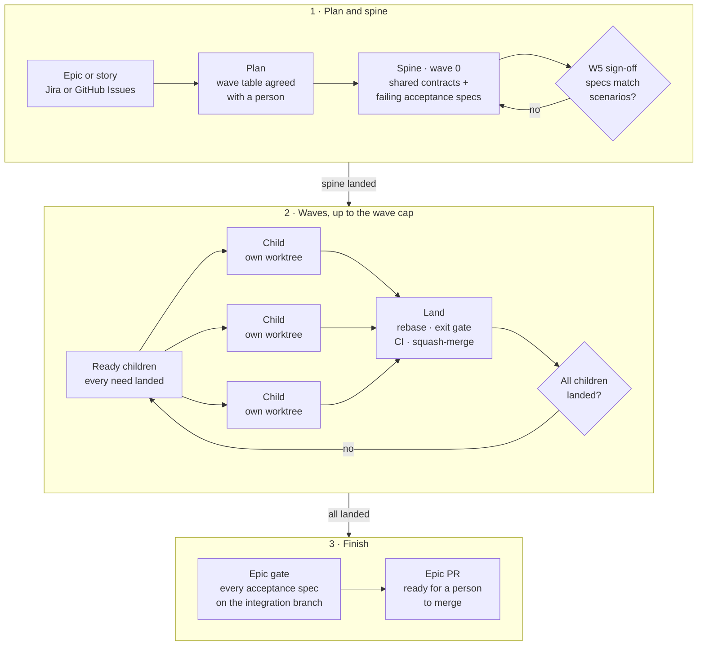

# Portia reference

Everything behind the [README](../README.md): how a run works, the profile, the plan block, every CLI command, gates and the safety rules. You only need this when you are writing a profile, debugging a run, or working on Portia itself.

## Contents

- [When to use Portia](#when-to-use-portia)
- [Principles](#principles)
- [Words Portia uses](#words-portia-uses)
- [How a run works](#how-a-run-works)
- [Requirements](#requirements)
- [Install](#install)
- [Configure a repository (the profile)](#configure-a-repository-the-profile)
- [The plan block](#the-plan-block)
- [Running Portia](#running-portia)
- [Driving a run: `portia drive`](#driving-a-run-portia-drive)
- [CLI reference](#cli-reference)
- [Watching runs: `portia view`](#watching-runs-portia-view)
- [Exit codes](#exit-codes)
- [Gates](#gates)
- [Design checks](#design-checks)
- [Decisions, retries and spend](#decisions-retries-and-spend)
- [Safety rules](#safety-rules)
- [Run state on disk](#run-state-on-disk)
- [Environment variables](#environment-variables)
- [Not built yet](#not-built-yet)
- [Development](#development)
- [Repository layout](#repository-layout)

---

## When to use Portia

Portia is built for **one feature that needs shared code and several workers**: an epic, or a story large enough to split, whose children depend on a common schema or contract and can then be built in parallel.

- **Good fit:** a feature with a shared contract and at least a few children that can run side by side once it exists, with acceptance scenarios a person can sign off.
- **Poor fit:** a single small change. A parent that one worker could finish is declined at planning time (`portia check` rule Y2), because the spine, waves and integration branch only cost time there.
- **Poor fit:** a batch of unrelated tickets. Portia lands everything as one feature in one PR, so unrelated work would be held back by each other's gates and review.

---

## Principles

1. **Test the whole feature first.** The spine writes every acceptance scenario as a failing spec, and a person signs off that each spec encodes its scenario before any wave starts. The epic gate is those same specs passing.
2. **Shared code lands first.** Schema, types and API shapes go in the spine, so later children build against contracts that already exist instead of inventing them in parallel.
3. **The plan lives in the tickets.** Each child's `plan` block and blocker links sit in the tracker, so there are no plan files in the repo to go stale, and anyone can read the plan where the work is tracked.
4. **Children land on an integration branch, never on main.** Each child is rebased, re-gated and squash-merged into `<branchPrefix>/<PARENT>`. **A person merges once**, when the whole feature is ready.
5. **Use the project's own rules.** Workers follow the target repository's CLAUDE.md files, project skills and settings; `portia permissions` only adds deny rules, never an allow.
6. **Keep workers apart.** Each child gets its own worktree, branch, port, database and services, and children in the same wave never touch the same file.
7. **The right model for each child.** A child's `tier:` picks a model from the profile, so routine children run on a cheaper model and hard ones on a stronger one.
8. **Visible from anywhere.** The ledger in the epic PR body shows one row per child and its state, rebuilt from the tracker, GitHub and the run log after every landing.

---

## Words Portia uses

| Word | Meaning |
| --- | --- |
| **Parent** | The epic or story Portia is asked to deliver. |
| **Child** | One piece of the parent, small enough for one worker. |
| **Spine** | The first child (wave 0). It lands the code every child shares, plus the acceptance specs, failing. |
| **Ready** | A child whose `needs` have all landed, so it can start now. `portia status` lists them. |
| **Wave** | The ready children that run at the same time. |
| **Wave cap** | The most children allowed to run at once (`waveCap`). |
| **Integration branch** | The parent's own branch. Children merge here, never straight into main. |
| **Exit gate** | The checks a child must pass before it finishes, run again on the rebased head before it lands. |
| **Epic gate** | The final check on the integration branch: every acceptance spec must pass before the epic PR is ready. |
| **Ledger** | A table in the epic PR description with one row per child and its state. |
| **Park** | Stop with one clear question for a person instead of guessing. |
| **Lane** | `light` or `full`. A light child skips the gate steps marked for the full lane. Every child is full unless the profile sets `lanes` or its block sets `lane:`. |

---

## How a run works



1. **Plan.** `portia plan context` gathers the parent, its open children, their blockers and the repo layout into one file. The skill drafts a plan from it, shows you a wave table (wave · key · summary · needs · files touched · scenarios) and waits for an explicit *yes*. `portia plan write` then checks the whole plan and writes a fenced `plan` block onto every ticket, linking each `needs` as a blocker.
2. **Intake.** `portia check` validates the plan as the tracker holds it. `portia integration init` creates the integration branch (`<branchPrefix>/<PARENT>`) and the draft epic PR; `env template` prepares a template database; `gate baseline` records the integration branch's existing TypeScript errors so children are only held to errors they introduce. With `askOnce` set, `portia questions` first gathers every open question about the plan (see [Open questions](#open-questions)) so the person answers them in one round before any worker starts.
3. **The spine (wave 0).** One child owns every shared schema and contract change and writes each scenario as a *failing* acceptance spec whose test titles start with the scenario id (`"F2: …"`). A scenario no later child can deliver, the spine may own: listed in its `requirements:` and in no later child's, it must pass at the spine's exit gate while every other spec still fails. Before a person signs off that each spec faithfully encodes its scenario, a reviewer checks the specs, starting from [spec coupling](#spec-coupling): a spec that depends on another scenario's feature is decoupled, or its owner gains a need on the child that delivers it. The spine lands only after the sign-off, and no later wave starts until it has.
4. **Waves.** For each ready child (up to `waveCap`): `env up` provisions a worktree, port, database and services; `dispatch` records the attempt and picks a model by tier, or, with `perWorkerMb`, holds the child back until a worker slot is free; `brief` renders the worker's full prompt; the spine's also carries the ticket of each later child that delivers one of its scenarios, since its failing specs assert what those tickets say. Workers commit on their own branch and finish with a single JSON result. Children in the same wave never touch the same file.
5. **Landing.** `portia land` rebases the child onto the integration branch, re-runs its exit gate on the rebased head, pushes, opens a PR into the integration branch, runs the profile's [child review](#child-review) at that head when it has one, waits for CI, squash-merges, transitions the ticket and updates the ledger in the epic PR body. Landings for different children run concurrently: each rebases and runs its exit gate in its own worktree at the same time as its siblings, its review runs while CI does, and `land.lock` covers only the fetch and the pin check, merge and landed row. A second `portia land` of the same child refuses at once while the first runs, and `portia resume` lists that child as `await-land`. A child only ever lands at the commit its gate passed: the merge is pinned to that sha (`gh pr merge --match-head-commit`), and just before it, under the lock, the child branch is checked again. A commit pushed on top after the gate is taken in, gated and reviewed again; a rewritten branch fails the landing with nothing merged. Without `landOnGatedTip`, a sibling may land between this child's rebase and its merge, during the gate as during CI, and the child still merges at its gated sha. With `landOnGatedTip`, the integration tip is pinned the same way, so every child lands on exactly the tip it was gated against: a tip that moved during the gate re-gates before the push, and one that moved later re-gates before the merge. A re-gate reviews the child again only when its diff changed (its patch id differs). CI counts only once GitHub reports the PR's head as that sha (one `gh pr view` reads the head and its checks together), so a green rollup left from an earlier head is never trusted. A landing re-gates at most five times; its last attempt holds the lock through CI, so no sibling can move the tip under it, and if its own head still moves it parks.

**The regression guard.** Every child landed earlier in the run proved its own scenarios pass on the integration tip, so the exit gate at land also runs them: after the profile's first exit step that uses `{owned}`, a copy of it named `regression-guard` runs with `{owned}` and `{ownedGrep}` filled with the scenarios landed children made pass, the spine's own included (a scenario several children list counts once all of them have landed). A child counts only once its merge is in the tip being gated: the landed children are read under `land.lock` with that tip, so a sibling that lands while this child gates is not held against it. A child that breaks one fails with `exit gate failed on the rebased head (R6): regression-guard` and nothing merges. With no such scenario yet (the spine, or the first child of wave 1 when the spine owns none) there is no `regression-guard` step. The copy keeps the step's `lanes` and `whenTouches`. It runs only at land, never in a worker's own `portia gate exit`. `regressionGuard: false` in the profile turns it off (`ratchet`, its former name, is still accepted).

The exit gate always runs on the rebased head, except when this land has already passed it on the same tree, rebased onto the same integration tip, with the same gate inputs (the profile, the child's lane, its owned scenarios and the regression guard's) and a clean worktree; then the pass is reused and the land says so. Only passes `portia land` ran count, never a worker's own `portia gate exit`. The landed row is written as soon as the merge is known, before the ticket moves; the transition is best effort, gives up after a minute, and is recorded as a `tracker` row, and `portia resume` retries one that never finished. If `gh pr merge` exits non-zero, the PR's state decides: a PR GitHub merged anyway is recorded as landed. A land of a child whose PR is already merged records it landed and stops, without rebasing or gating again. When one PR built several children, so none merged from its own branch, `portia land <KEY> --parent <PARENT> --merged-in <PR>` records each of them landed from that PR the same way, after checking the PR is merged into the integration branch; it refuses any other PR. A rebase an interrupted land left behind in the worktree is aborted before the next rebase.

When CI or GitHub fails a land rather than the child's code (no checks registered, checks still pending after `checksTimeoutMin`, or a merge refused for anything but a moved head), its JSON carries `"infra": true`: run `portia land` again, and `portia resume` lists it as `land`, not `decide-failure`. After two such failures in a row the third parks the child for a person. A failing check or an exit gate that fails on the rebased head still goes to `portia decide failure`.

6. **Wave gate (optional).** With `waveGate` in the profile, once every child of a wave has landed (or was closed outside the run) and before any child of the next wave is ready, `portia gate wave <PARENT>` runs the named `gates.epic` steps once on the integration tip. `portia status --json` reports `waveGate: { wave, due: true }` (and exits 0) while one is due, `portia resume` lists a `wave-gate` action, and the next wave stays pending until a wave gate has passed for every earlier wave, in `status`, the ledger and `portia view` alike (the plan snapshot records `waveGate: true` so the view, which reads no profile, can tell). It catches what no child's slice runs, such as specs that interfere only when the whole suite runs, a wave after it happens rather than at the epic gate.
7. **Epic gate.** `portia epic` runs the profile's epic steps (including every acceptance spec), the browser check and a second-vendor review on the integration branch. On success the epic PR is ready. **A person merges it; Portia never merges to main.**

---

## Requirements

| Tool | Why |
| --- | --- |
| [Bun](https://bun.sh) | Runs the CLI (`#!/usr/bin/env bun`) and installs dependencies |
| git | Worktrees, rebases, branches |
| [GitHub CLI](https://cli.github.com) (`gh`), authenticated | PRs, checks, merges, and the GitHub Issues tracker |
| [Claude Code](https://docs.claude.com/claude-code) | Runs the `portia` skill and the workers (subagents, or headless `claude -p` processes in detached mode) |
| Postgres client tools (`createdb`, …) | Only if the profile sets `db` |
| Docker | Only if the profile defines `services` |
| Playwright Chromium | Only for design checks (`bunx playwright install chromium`) |

For a **Jira** tracker you also need `JIRA_BASE_URL`, `JIRA_EMAIL` and `JIRA_API_TOKEN` (see [Environment variables](#environment-variables)).

---

## Install

See [Get started](../README.md#get-started) in the README. The one-line `scripts/install.sh` installs Bun if it is missing, clones the latest release into `~/.portia/src`, links `src/cli/main.ts` into `~/.bun/bin/portia` and each skill in `skills/` (`portia`, `portia-setup`) into `$CLAUDE_CONFIG_DIR/skills/` (`~/.claude/skills/` when that is unset). Run from a checkout, it links that checkout instead. `--ref <tag>` picks a version, `--design` adds Chromium, and `--uninstall` removes the links and keeps `~/.portia`. The other route is `bun add -g @mousedown/portia` for the CLI with the Claude Code plugin (`/plugin install portia --marketplace mousedown/portia`) for the skills, namespaced as `/portia:portia` and `/portia:portia-setup`.

---

## Configure a repository (the profile)

`portia init` (or the `/portia-setup` skill) writes a profile from a short interview: it detects the tracker from the git remote and `JIRA_BASE_URL`, the checks from `package.json` scripts and the worker count from memory, and asks only about what you want to change. The rest of this section is for editing a profile by hand.

Portia ships no project profiles. It looks for one in three places, first match wins:

1. **`PORTIA_PROFILE`**: an absolute path to a profile file.
2. **`portia.config.ts` at the root of the target repository**, for a profile committed with the repo.
3. **`~/.portia/profiles/<repo>.ts`** (`$PORTIA_HOME/profiles/<repo>.ts`), for a private profile kept outside the repo. `<repo>` is the main checkout's folder name, taken from `git rev-parse --git-common-dir`, so a child worktree finds the same profile.

When none exists, the error lists all three. When the profile came from `PORTIA_PROFILE` or `~/.portia/profiles`, each worker's brief tells it the absolute path, so its `portia` commands load the same profile.

The file's default export is validated against `ProfileSchema` in [`src/core/config.ts`](../src/core/config.ts); an invalid profile fails with a list of every bad field. A profile outside the repo is imported from wherever it lives, so it may import only Node built-ins or absolute paths.

A minimal profile (adapted from the end-to-end fixture, [`test/e2e/fixture-repo/portia.config.ts`](../test/e2e/fixture-repo/portia.config.ts)):

```ts
import { homedir } from "node:os";
import { join } from "node:path";

const step = (name: string, cmd: string) => ({ name, cmd, heavy: true, cwd: "root" as const });

export default {
  repo: "my-app",
  branchPrefix: "epic",
  tracker: { kind: "github", repo: "my-org/my-app" },
  packageDir: ".",
  worktreesDir: join(homedir(), ".portia", "worktrees"),
  waveCap: 2,
  minFreeMb: 0,
  ports: [3200, 3299],
  portEnv: ["PORT"],
  services: [],
  debt: [],
  models: { high: "opus", standard: "sonnet" },
  transitions: { running: "running", landed: "landed" },
  gates: {
    task: [step("test", "bun test")],
    exit: [step("test", "bun test")],
    epic: [step("test", "bun test"), step("acceptance", "bun test {acceptance}")],
  },
  allowedIncidental: [],
  sensitiveGlobs: [],
  design: { pass: 0.02, fail: 0.1, personas: {} },
  secondVendor: "true",
  agentBrowser: "true",
  jev: { enabled: false },
  spend: { worker: 2_000_000, wave: 4_000_000, epic: 8_000_000 },
  maxRetries: 1,
  denyRules: ["Bash(gh pr merge*)", "Bash(git push*main*)"],
};
```

A fully commented profile for a fictional monorepo, showing every option (Postgres, a Docker search service, conditional and retried gate steps, `gateEnv`, `briefNotes`, debt rules, design personas), is in [`examples/profile.example.ts`](../examples/profile.example.ts).

### Profile fields

| Field | Default | Meaning |
| --- | --- | --- |
| `repo` | — | Repository name. |
| `branchPrefix` | `"portia"` | Prefix for every branch Portia pushes (`<prefix>/<KEY>`) and for GitHub tracker labels. Lowercase; may not be `main` or `master`. **Changing it mid-run orphans that run's branches.** |
| `tracker` | `{ kind: "jira" }` | `{ kind: "jira" }` or `{ kind: "github", repo: "owner/name", keyPrefix?: "GH", keys?: "number" \| "title" }`. `EXT` is reserved. See [GitHub keys](#github-keys). |
| `packageDir` | — | The app package inside the repo (`.` for a single-package repo). Gate steps with `cwd: "package"` run here. |
| `worktreesDir` | — | Where child worktrees are created. |
| `waveCap` | — | Most children running at once in a wave. |
| `minFreeMb` | — | `env up` refuses to start a worker below this much free memory. |
| `perWorkerMb` | *(none)* | Memory one worker needs, its services included. When set, `dispatch` sizes each wave from free memory and the other runs on the machine; see [Worker slots](#decisions-retries-and-spend). Unset, the wave cap is all that limits a wave. |
| `ports` | — | `[low, high]` range each worker's dev-server port is allocated from. Every run on the machine draws from one pool (`runs/ports.json` under the Portia home), and a port another process already listens on, or that a child's environment still records, is passed over. |
| `portEnv` | — | Env var names that each receive the worker's port. |
| `db` | *(none)* | Optional Postgres: `pg` connection (`host`, `port`, `user`, `password`, `prefix`) and a `migrate` command plus its `cwd` (`root`, `package` or a path). Each child gets its own database cloned from a template. |
| `services` | — | Docker services (`name`, `image`, `args`, `containerPort`, `env`). A service starts only when the child touches one of its `whenTouches` globs; `{port}` in `env` becomes its host port. Env lines are written to `.env.portia`. |
| `debt` | — | Debt rules (`name`, `pattern`, optional `exclude`): regexes tested against every added line in the exit gate. |
| `models` | — | Model per tier: `{ high, standard }`, plus an optional `small`. A child's `tier:` picks one; with `small`, a child sized XS or S that is not the spine runs on `small` instead. A `tier: high` on such a child keeps it on `high` only when its touches reach a `sensitiveGlobs` path, so the same ticket runs on the same model whichever tier a plan gives it. |
| `transitions` | — | Tracker status names for `running` and `landed`. |
| `gates` | — | `task`, `exit` and `epic` step lists, and an optional `secretScan: { cmd?, allow? }`. See [Gates](#gates) and [Secret scan](#secret-scan). |
| `allowedIncidental` | — | Globs a child may change outside its `touches` without parking (e.g. lockfiles). |
| `ripple` | `{ tests: [common test globs], generated: [] }` | What a file outside a child's `touches` is. `tests` globs mark test-only files: specs, fixtures, mocks and test setup (the default covers `*.test.*`, `*.spec.*`, `*.itest.*`, `*.e2e.*`, the `test`, `tests`, `spec`, `specs`, `specs-it`, `e2e`, `__tests__`, `__mocks__`, `__fixtures__` and `fixtures` directories, and `test-setup`, `setup-tests`, `setupTests`, `vitest.setup` and `jest.setup` files). `generated` globs mark generated output, such as types a schema change rewrites; a file matching both is generated. Every other file is production. Planning, results, the ledger and insights all use this one classification. See [Ripples](#ripples). Unknown keys are rejected. |
| `sensitiveGlobs` | — | Code that is never delegated to an automated decision (e.g. `**/auth/**`, `**/payments/**`). |
| `design` | — | Design check thresholds (`pass`, `fail` — mismatch ratios) and `personas`: name → `"<module relative to e2e>#<exportName>"`. |
| `secondVendor` | — | Command run in the epic gate for an independent review (e.g. `codex review --base main`). `"true"` to skip. |
| `review` | *(none)* | Optional `{ child: { cmd, timeoutMs?, onFindings? } }`: a review of each child's diff before it lands. `timeoutMs` defaults to `1200000` (20 minutes), at most 24 hours; `onFindings` is `"fail"` (default) or `"park"`. Unknown keys and an empty `review` are rejected. See [Child review](#child-review). |
| `agentBrowser` | — | Command run in the epic gate to check the app in a browser; `{baseUrl}` is substituted. `"true"` to skip. |
| `jev` | — | `{ enabled, url? }`: an optional HTTP decision service consulted for retry/park decisions. |
| `spend` | — | Token caps: `{ worker, wave, epic }`. `dispatch` refuses past any cap. |
| `briefNotes` | `[]` | Lines for an "Environment" section at the end of every worker brief. |
| `gateEnv` | `{}` | Env vars for every gate step; a worker's `.env.portia` overrides them. |
| `ci` | `true` | `false` for a repo with no CI: a land merges once its exit gate and review pass, without waiting for checks that will never appear. |
| `ciWaitMs` | `300000` | Most milliseconds a child PR's checks may take to appear; a missing check fails sooner once no CI run for the head is active. |
| `checksTimeoutMin` | `45` | Minutes a child PR's CI may stay pending before the landing fails. |
| `ciChecks` | `[]` | CI check names a landing waits on; empty means every check gates. |
| `regressionGuard` | `true` | At land, the exit gate also runs every scenario a child landed earlier in the run made pass, as a copy of the first `{owned}` step named `regression-guard` (see [Landing](#how-a-run-works)). |
| `schedule` | `"waves"` | How children wait. `waves`: a wave is ready once every earlier wave has landed. `needs`: a child is ready once the spine, its declared needs and every earlier-wave child whose touches overlap its own have landed, so independent children of later waves start without waiting for whole waves. With `waveGate` set, waves stay strict. The plan snapshot records `byNeeds: true` so `portia view` agrees. |
| `specsSignoff` | `"person"` | Who signs off the spine's specs. `person`: drive stops at `spec-signoff` every time. `when-clean`: when `portia plan specs` finds no coupling, drive records the sign-off itself with `by: "rule"`, so the plan's yes is the one human checkpoint before the epic PR; a flagged coupling still stops. Rule sign-offs are not counted as human decisions. |
| `waveGate` | — | `{ steps: ["<epic step>", …] }`: `gates.epic` steps that `portia gate wave` runs on the integration tip after each wave lands; the next wave waits for them to pass. A name that is not a `gates.epic` step fails the profile. Absent, there is no wave gate. |
| `landOnGatedTip` | `false` | A child merges only onto the integration tip its rebase was gated against. If another child landed while it waited on CI, it rebases, gates and waits on CI again before merging. |
| `directLand` | *(none)* | Optional `{ maxChildren: 4 }`. An epic of at most `maxChildren` children, none with a `design:` line, lands each child without a PR or CI wait of its own: after the same exit gate on the rebased head and the child review, and under `land.lock`, its gated tree goes onto the integration branch as one commit (subject `<PR title> [<KEY>]`, trailer `Portia-Child: <KEY>`), fast forward only, on exactly the tip it was gated against; a tip that moved re-gates first. The landed row has `direct: true`, the pushed commit as `sha` and the gated head as `gated`. A land that died after its push finds the commit by its trailer and records it landed. CI still runs on the epic PR before main, and nothing is pushed to main. |
| `maxRetries` | — | Automatic retries after a failed worker before it parks. |
| `maxSize` | `"S"` | Largest child size the plan's size rule accepts (`XS` < `S` < `M` < `L`). Bigger tickets must be split. |
| `excludeLabels` | `[]` | Children carrying any of these labels (case-insensitive) are never planned. |
| `lanes` | *(none)* | Optional `{ maxSize: "S", fullTouches: [] }`. With it, a child is in the light lane when it is no larger than `maxSize`, is not the spine, has no `design:` line, and touches none of the spine's `touches`, `sensitiveGlobs` or `fullTouches`; every other child is full. Without it, every child is full. See [Lanes](#lanes). |
| `askOnce` | `false` | Ask every open question before wave 0: `portia questions` collects them, `dispatch` refuses until `portia answer` has recorded an answer to each, and each brief carries the answers. See [Open questions](#open-questions). |
| `denyRules` | — | Claude Code permission deny rules `portia permissions` adds to the checkout's local settings. |
| `notify` | `{ remindMin: 30 }` | How a park for the person is announced: a desktop notification, then once more after `remindMin` minutes if still unanswered. `onPark` replaces the desktop notification with a command (`{parent}`, `{child}`, `{question}`, `{attempt}`); `false` switches it off. See [Parked questions](#parked-questions). |
| `workers` | `{ mode: "subagent" }` | How workers run. `mode`: `"subagent"` (a background subagent in the orchestrator's session) or `"detached"` (a headless process the CLI starts; see [Detached workers](#detached-workers); `portia drive` requires it). `command` (default `"claude"`), `args` (default `["--output-format", "stream-json", "--verbose"]`; Portia adds `--settings <file> --add-dir <run dir> --tools <role's tools> --strict-mcp-config --mcp-config <file> -p --model <model>` after them) `stallMin` (default `20`; keep it longer than your slowest quiet command), `accounts` (default `[]`), `limitCooldownMin` (default `60`) and `roles` (default `{}`) apply only to detached workers; see [Accounts](#accounts) and [Worker tools](#worker-tools). |

### GitHub keys

A GitHub tracker names issues one of two ways, set by `tracker.keys`:

- **`number`** (the default): a key is `<keyPrefix>-<issue number>`, so `GH-42` is issue #42. `keyPrefix` defaults to `GH`.
- **`title`**: a key is whatever ticket key an issue's title starts with, written `<KEY>: …` or `[<KEY>] …`, so an issue titled `ACME-500: Checkout` is `ACME-500` whatever its number. The key's prefix need not match `keyPrefix`, and a title starting `EXT-` carries no key. The first command that needs a key lists every issue in the repository once (open and closed, pull requests left out) and keeps the key-to-number map for the rest of that command. A key no title starts with, or that starts more than one title, fails with a message naming the repository. Children are still the parent's sub-issues, and blockers are its `blocked by` dependencies; each child's and blocker's key is read from its own title, which must carry one. The key is left out of the summary, so commit and PR titles do not repeat it.

```ts
tracker: { kind: "github", repo: "my-org/my-app", keys: "title" },
```

---

## The plan block

The plan lives **in the tickets themselves**, as a fenced block tagged `plan` in each ticket's description. (Blocks tagged `portia` on older tickets still parse; write new ones as `plan`.) `portia plan write` creates them for you, but you can read and edit them in the tracker.

**Parent** — the PR title scope and one line per acceptance scenario:

````text
```plan
scope: booking
scenario: F1 = Given a shop with open slots, Then a customer can book one
scenario: F2 = Given a booked slot, Then it no longer shows as open
```
````

**Spine child (wave 0)** — owns shared contracts and writes every scenario as a failing acceptance spec. It lists in `requirements:` only a scenario no later child can deliver, which it then makes pass; here the wave children deliver both, so it lists none. Each spec sits inside the touches of the child that owns its scenario, and the spine lists each spec file in its own touches by its exact path. A `hook:` line names a stub module the spine scaffolds where one child's feature plugs into another's (here the slots child's hold check, which booking calls): the file is in the spine's touches and in those of the child that fills it, with what the stub holds after the `#`:

````text
```plan
wave: 0
touches: packages/app/src/booking/types.ts, packages/app/src/slots/hold.ts, packages/app/specs/booking/book.test.ts, packages/app/specs/slots/slots.test.ts
evidence: bun test specs/booking/book.test.ts specs/slots/slots.test.ts
tier: high
size: S
hook: packages/app/src/slots/hold.ts # holdSlot(slotId) returns true until the slots child fills it
acceptance: F1 = packages/app/specs/booking/book.test.ts
acceptance: F2 = packages/app/specs/slots/slots.test.ts
```
````

**Wave child** — with a dependency and, optionally, a design reference:

````text
```plan
wave: 1
needs: PROJ-101 # uses the booking types from the spine
touches: packages/app/src/booking/**, packages/app/specs/booking/**
requirements: F1
evidence: bun test specs/booking/book.test.ts
tier: standard
size: S
design: https://figma.com/… route=/book persona=parent frames=Desktop,Mobile
```
````

A child block may also set `lane: light` or `lane: full`, which overrides the lane Portia derives (see [Lanes](#lanes)).

### Open questions

With `askOnce: true` in the profile, `portia questions <PARENT>` collects, after the plan is approved and before any worker is dispatched, everything a worker would otherwise park on:

| Kind | Asked when |
| --- | --- |
| `open` | A ticket lists questions under a `Questions` (or `Open questions`) heading: the list items, or lines ending in `?`, up to the first other line. Or a plan block has a line starting with `?`, which the block parser skips only with `askOnce`; without it the line is a parse error, so no question is dropped unasked. |
| `detail` | A child's ticket says nothing beyond its plan block. |
| `touches` | A child's `touches` glob matches no file in the repo (new, or a wrong path?), or over 100 files. |
| `warning` | `portia check` warns (anything but `unplanned` and `closed`). The answer is a note for the worker: the plan stays as written, so to change it, stop, edit the tickets and run `portia check` and `portia questions` again. |

````text
```plan
wave: 1
? should the badge show on mobile
touches: packages/app/src/badge/**
…
```
````

It prints the unanswered questions as a JSON array of `{ id, child?, kind, question }` and records them in the run directory: exit 0 when there are none, 11 when the person must answer. A real problem (the tracker or git failing) also exits 11, but writes to stderr and prints no JSON. `portia answer <PARENT> --from <file>` records answers from `{ "<id>": "<answer>" }` and prints what is still open, exit 0 once nothing is. Running `portia questions` again keeps each answer whose question is unchanged. Each child's brief gets an "Answers from the person" section with its own answers and the epic's (questions with no `child`). Children landed or closed outside the run are not asked about. While questions are uncollected or unanswered, `portia status` lists that as a warning and `portia resume` reports an `answer-questions` action ahead of any other, so a resumed run answers them before it redispatches.

### Plan rules (`portia check`)

| Rule | What it enforces |
| --- | --- |
| `completeness` | Every child block has every required line. |
| `coverage` | Every scenario is owned by some child, a later-wave child or the spine, through its `requirements:`, and has an acceptance spec. A scenario the spine lists that a later child also lists is a warning: it is left to that child, since the spine lands first and cannot complete it. |
| `graph` | `needs` form a DAG and point to earlier waves (or done tickets, which count as met). |
| `overlap` | No two children in the same wave touch the same file. |
| `spine` | Wave 0 exists, owns the acceptance specs, and has one `acceptance:` line per scenario. |
| `specs` | Each `acceptance: <id> = <path>` sits inside the touches of the child that owns `<id>` (a later child listing it in `requirements:`, or the spine when none does), so the epic changes no path its tickets do not declare; an error names the scenario, the path and the owner's touches, and suggests a path under them (`specs/<feature>/<file>`). The spine writes every spec, so its touches must hold each path too: list the file itself, which leaves the owner's lane as it was. |
| `hook` | A `hook:` line is on the spine and its file is in the spine's touches (errors), and in some later child's touches, the child that fills it (a warning). A warning, too, when two later children's tickets meet at one point, a route both name that the parent's and the spine's tickets do not, or a file one names under the other's touches, and no hook sits in either's touches: one feature plugs into the other's code, so the spine should scaffold the hook. When one needs the other, the warning names it as the one plugging in. |
| `size` | No child is larger than `maxSize`. |
| `parse` | Every block parses; no block names the tool. |
| `unplanned` / `excluded` / `closed` | Open children without a block, children carrying `excludeLabels`, and children closed outside the run. |
| `lane` | Info only, when lanes are in use: each child's lane and why. |
| `ripple` | Warning: a production file outside a child's `touches` imports one of its modules, naming the child and the file, so the planner can widen the touches before the go. Test and generated ripples are listed, not warned about. See [Ripples](#ripples). |

### Spec coupling

The spine writes every scenario's spec before any later child starts, so a spec can assert more than its scenario: an order history spec that checks a price including a surcharge another child adds. Its owner's exit gate then fails on a feature it does not own and cannot wait for, and it parks. `portia plan specs <PARENT> [--dir <checkout>] [--json]` reads each acceptance spec from its spine's worktree (or `--dir`) and lists, as `coupling` warnings, a spec that reaches a later child its scenario's owner does not need, directly or through another need:

- `import`: it imports a module under that child's touches, whether or not the file exists yet (relative paths and tsconfig `paths` aliases).
- `route`: it requests a route (a string such as `` `/orders/${id}/pay` ``) that the child's ticket names (`/orders/:id/pay`), that the owner's own ticket does not, and that no file outside the child's touches already holds, the acceptance specs aside.

It is read-only and exits 0 either way; `--json` prints `{ coupling: [{ scenario, spec, owner, other, via, target }] }`. The skill gives the list to the spec reviewer, who confirms or dismisses each entry and looks for dependencies a static read cannot see. A confirmed one is settled before the sign-off: the spine decouples the spec when the scenario does not require the other feature, or else the owner, not yet started, gains a need on that child through `portia plan write`. `portia drive` runs the same check before it applies any specs sign-off, a scripted one included: with any coupling it signs nothing off and stops at `spec-signoff` with the entries in `coupling`, so they are settled (or dismissed, and the sign-off recorded by hand) before the spine lands.

### Ripples

A change ripples into files that import what it touches: the specs and fixtures of a type it changed, shared test setup, the types generated from a schema. `portia plan write <PARENT> --from <file> --json` adds `ripples`, each child's importers outside its touches as `{ file, kind }` with `kind` `test`, `generated` or `production` (the profile's [`ripple`](#profile-fields) globs decide), and a production one is a `ripple` warning.

At run time a child may change test and generated files outside its touches without parking: its result is accepted and the result row records them as `ripples` (`[{ file, kind }]`). It still parks with `touched files outside its Touches` when any such file is production, matches `sensitiveGlobs`, or is in the touches of another child in the same wave; the question names only those files, and the child that touches each. The ledger lists a landed child's ripples.

`portia insights --json` splits the parked cause in `parks`, as `[{ on, count, tokens }]`, where `count` and `tokens` are those of the parked cause's attempts:

| `on` | A park that |
| --- | --- |
| `production-ripple` | parked with `touched files outside its Touches` and names at least one production file. A park naming any production file counts here, even when it also names test or generated files. |
| `test-ripple` | parked with `touched files outside its Touches` and names only test or generated files (another child in the wave touches them, or they match `sensitiveGlobs`). |
| `question` | is any other worker question. |
| `failure` | is a failure `portia decide failure` answered with park. It is a park on the child's failure, not on a question, so it stays apart from the three above. |

A kind with no parks may be left out or listed with `count: 0`.

---

## Running Portia

Open Claude Code in the **root of the target repository** (the one with `portia.config.ts`) and ask:

```text
/portia PROJ-123        # a Jira epic or story
/portia GH-42           # a GitHub issue (with tracker.kind = "github")
portia resume PROJ-123  # pick up an interrupted run
```

The skill walks through planning, intake, designs, each wave and the epic gate, and stops to ask you at the points that need a person:

- approving the plan's wave table before anything is written to the tracker;
- with `askOnce`, one round of every open question before the spine starts;
- the **W5 sign-off** on the spine's acceptance specs;
- every **parked** question from a worker (see [Parked questions](#parked-questions));
- main conflicts on the integration branch;
- a spend cap being reached;
- the final review and merge of the epic PR.

The skill plans, then runs `portia drive` and acts only on the stop it names (see [Driving a run](#driving-a-run-portia-drive)), so a run takes a handful of AI turns rather than one per step. Long commands (`drive`, `land`, `epic`, `gate baseline`, `env template`, `worker wait`) can run for more than ten minutes, so the skill runs them in the background.

### Detached workers

By default each worker is a background subagent in the orchestrator's Claude Code session, so it stops when that session does. With `workers.mode: "detached"`, the CLI starts each worker itself as a headless process that outlives the orchestrator:

1. `portia dispatch` adds `"worker":"detached"` to its JSON, which tells the skill to start no subagent.
2. `portia worker start <KEY> --parent <PARENT>` renders the brief and runs `<command> <args…> --settings <file> --add-dir <run dir> -p --model <model>` in the child's worktree, with the brief on stdin and its output appended to a log in the run directory. It records the pid, the process's start time, the log, the result file and the start time in `worker-<KEY>.json`. The brief tells the worker to write its one JSON result to `result-<KEY>-<attempt>.json` as well as sending it; when that file is missing, the text of the log's final `result` line is read instead. `--note-file <file>` appends the file to the brief under "Answer from the person", for a redispatch that carries a person's answer or notes. It refuses an attempt whose worker still runs or has finished uncollected, and stops an older attempt's worker (SIGTERM, then SIGKILL) before starting a newer one in the same worktree.
3. `portia worker wait <KEY> --parent <PARENT>` polls the worker (every 5 seconds; `--poll <seconds>` changes it) and, once it has finished, applies its result exactly as `portia result` does, with the same JSON and exit codes. If the run has dispatched a newer attempt meanwhile, it applies nothing and exits 10 with `"stale":true`. Tokens come from the `result` line of a `stream-json` or `json` log; a worker stopped or killed before writing one counts the usage of each assistant message its `stream-json` log holds, so spend caps still see it, and with neither its tokens count as 0.

A worker **stalls** when its process has exited without writing its result, or when for `stallMin` minutes its log has not grown, its worktree has not changed (the last commit, or the time a changed file was last written) and its process tree has used under 5% of one CPU. A worker whose `portia` command is waiting its turn for a lock (a heavy gate step, say) is not idle: the wait counts as progress. A stalled worker is stopped and recorded as a failed result whose reason starts with `stalled:`, so `portia decide failure` retries or parks it like any other failure. `portia worker wait`, `portia status` and `portia resume` all detect stalls. `portia status` reports each detached worker as `alive`, `finished` or `stalled` under `workers` in its JSON; `portia resume` also applies the result of a worker that finished while nothing was waiting, and lists a live one as `await-worker` rather than `redispatch`. A headless session writes nothing while a tool call runs, and gitignored output does not count as a change, so set `stallMin` longer than the slowest command a worker runs that stays quiet and idle (a long gate or evidence command waiting on a server, say). A pid whose process start time no longer matches the record counts as exited, so a reused pid is never signalled.

### Accounts

Detached workers can share the load across several Claude subscriptions. List each login under `workers.accounts`, each with a name and its own Claude Code config directory, or no `configDir` for the default login (the one plain `claude` uses):

```ts
workers: {
  mode: "detached",
  accounts: [
    { name: "work", configDir: "~/.claude-work" },
    { name: "personal" }, // the default login
  ],
},
```

Log each one with a `configDir` in once with `CLAUDE_CONFIG_DIR=~/.claude-work claude` and `/login`. A worker on an account without one runs with `CLAUDE_CONFIG_DIR` removed from its environment, even when the orchestrator has it set, so it always gets the default login.

A worker with no stored login (a clean `CLAUDE_CONFIG_DIR`, as in a headless eval) can take a token instead. Claude Code strips `CLAUDE_CODE_OAUTH_TOKEN` from the commands its shell tool runs, so a worker an orchestrator session starts never inherits it. Set `PORTIA_WORKER_TOKEN_FILE` to a file holding the token (from `claude setup-token`, owner-only): `portia worker start` passes its contents as `CLAUDE_CODE_OAUTH_TOKEN` to every worker without a `configDir`.

On macOS, pointing `configDir` at `~/.claude` is not the same as the default login. Claude Code keys its stored login by config directory, and the default login is stored for an unset `CLAUDE_CONFIG_DIR`, so `CLAUDE_CONFIG_DIR=$HOME/.claude claude -p "reply ok"` says "Not logged in" where `claude -p "reply ok"` works. Leave `configDir` out for that account instead.

Then:

- `portia worker start` gives each worker the next account in rotation (`CLAUDE_CONFIG_DIR` in its environment), skipping any account at its usage limit. It prints the account's name in its JSON as `account` and records it in `worker-<KEY>.json`. In `portia view`, the Run page adds an account column after Model (from 100 columns) and names it in the dock under the list, the Child and Worker pages show it beside the pid, and the Machine page lists each account under Workers with how many live workers run under it and any limit it is waiting out. With every account at its limit, it exits 11 and says when the first one frees.
- When a worker fails and its log ends on Claude Code's own usage-limit signal (a rejected `rate_limit_event`, an assistant message flagged `rate_limit`, or an error `result` whose text is a limit message), that account is benched until the reset time the message names. A message with no time Portia can read benches it for `limitCooldownMin` minutes. Nothing a tool printed counts. The failure's reason starts with `usage-limit:`.
- When a worker fails and its log ends on Claude Code's own login failure (an assistant message flagged `authentication_failed`, or an error `result` saying it is not logged in), the failure's reason starts with `not-logged-in:` and names the account and its `configDir` (or the default login). That account is benched until `portia accounts clear` lifts it, since a login does not come back on a timer: log it in, then clear it.
- `portia decide failure` retries a `usage-limit:` or `not-logged-in:` failure whenever another account is free. The retry spends none of `maxRetries`, since the limit or the login was the account's and not the child's. With every account at its limit or logged out it parks the child, and its `why` names when each account frees.
- `portia dispatch` refuses (exit 11) to dispatch a detached worker while every account is at its limit.
- `portia accounts` lists each account, its config directory (or the default login), and any limit it is under or that it is not logged in (`--json` for JSON), and exits 10 when none is free. `portia accounts clear [<name>…]` lifts a limit early, for example after a reset that came sooner than Portia read, or after upgrading a plan, and lifts a logged-out account once it is logged in. The Machine page in `portia view` shows a logged-out account as `not logged in`.

The rotation and the limits are kept in `accounts.json` under the Portia home, behind a lock, so every run on the machine shares them. Without `accounts`, the same detection and decisions apply to the one login the CLI runs under, called `default`, and no `CLAUDE_CONFIG_DIR` is set. `accounts` needs `mode: "detached"`, because a subagent runs under the orchestrator's own login. Spend caps still count tokens per run, not per account. Check that your subscriptions' terms allow how you use them.

The worker runs outside the orchestrator's session, so the checkout's `.claude/settings.local.json` (where `portia permissions` writes) does not reach it. Instead each start writes the profile's `denyRules` to `worker-<KEY>-<attempt>.settings.json` and passes it with `--settings`, and passes the run directory with `--add-dir` so the worker may write its result file there. Portia grants nothing else: a headless worker needs to edit files and run its gates, so give it what it needs through the target repository's Claude Code settings or permission flags in `workers.args` (for example `--permission-mode acceptEdits` and `--allowedTools`); the deny rules still apply over them.

### Worker tools

Each detached worker loads only the tools its role uses, so no other tool's definition is sent on every turn and the worker cannot call one. A spine, child, amendment or fix worker gets `Bash`, `Read`, `Edit`, `Write`, `Grep` and `Glob` (`--tools`), and no MCP server at all: Portia passes `--strict-mcp-config` with `worker-<KEY>-<attempt>.mcp.json`, so the servers in the user's and the repository's own config are not loaded. `workers.roles` adds to one role, leaving the others as they are: `tools` names more built-in tools, and `mcpServers` the MCP servers that role loads, each as a `.mcp.json` entry. For example, children that check a design in a browser:

```ts
workers: {
  mode: "detached",
  roles: {
    child: { mcpServers: { playwright: { command: "npx", args: ["@playwright/mcp@latest"] } } },
  },
},
```

The roles are `spine`, `child`, `amend` and `fix`. An MCP tool comes with its server, so `tools` refuses a name starting `mcp__`.

### Parked questions

A child that parks for the person (a worker's question, a parked land, or a failure decided as park) is announced the moment it is recorded: by `portia result` or `portia worker wait` when they write a parked result, by `portia land` when it parks a land, and by `portia decide failure` when it answers park. By default that is a desktop notification, `Portia <PARENT>` / `<CHILD> is waiting on you: <the question's first line>`, through `osascript` on macOS or `notify-send` on Linux (nothing elsewhere). A park the run clears itself, every account at its usage limit, is not announced.

A parked question can also be answered in `portia view`, right on Home: pick one of the worker's suggested answers or type your own (see [Watching runs](#watching-runs-portia-view)). The view appends it to the child's run log, so it waits there whether or not the session that drives the run is still open. The skill waits on it with `portia answers wait <PARENT> --since <at>` (exit 0 once an answer lands, exit 10 when nothing waits) and drives again; `portia drive` then redispatches the child with the answer, as it does for one given with `--answer`.

A worker that parks on a question with real alternatives adds `options` to its result, 2-4 short suggested answers, and `recommended`, the index from 0 of the one it recommends. They are carried into the `result` row's `data`. Anything malformed is dropped silently and never fails a result: an `options` that is not an array, an entry that is not a non-blank string, more than 4 (the first 4 stay), fewer than 2 left (none), and a `recommended` that is not one of those kept. A question without them takes a typed reply; options are never read out of the question's prose.

If the question is still unanswered `notify.remindMin` minutes later (30 by default), it is announced once more, never again. `portia status`, `portia resume` and `portia worker wait` (once a minute while it polls) look for questions that are due, and `notify.json` in the run directory records each reminder before it is sent, so however many of them look, each park is reminded at most once. A park ends when the child is dispatched again, lands, or an answer is recorded for it.

`notify.onPark` replaces the desktop notification with your own command:

```ts
notify: { onPark: "terminal-notifier -title 'Portia {parent}' -message '{child}: {question}'", remindMin: 30 },
```

The command is split into words as a shell would split them (single and double quotes group, a backslash escapes), then run without a shell, with `{parent}`, `{child}`, `{question}` and `{attempt}` filled in inside their words. The question is free text, so this is what keeps it from ever running as a command: `$(…)`, backticks, `;` and quotes in it reach your command as plain characters. The same values are in `PORTIA_PARENT`, `PORTIA_CHILD`, `PORTIA_QUESTION` and `PORTIA_ATTEMPT`, and `PORTIA_REMINDER` is `1` on the reminder; read those if your command needs a shell (`sh -c '… "$PORTIA_QUESTION"'`), never splice a placeholder into a shell script. `notify: false` switches notifications off. A notifier that fails or is missing is logged and never fails the command that recorded the park.

### Try it without side effects

Add `--dry-run` to any command. Run state goes to a fresh temp directory instead of `~/.portia` (profiles are still read from `~/.portia/profiles`), CI waits are skipped, and merges and transitions are only printed.

```sh
portia --dry-run status PROJ-123
```

### Scripted answers for evals

A headless run (`claude -p "/portia <KEY>"`) has no one to ask. Set `PORTIA_EVAL_ANSWERS` to a JSON file and the skill takes its answers from `portia eval-answer` before asking anyone:

```json
{
	"plan": { "approve": true },
	"signoff": { "approve": true },
	"parked": {
		"default": "Use what the tickets say; if they don't say, take the simplest reading, note what you assumed in your commit message, and carry on.",
		"byPattern": [
			{ "match": "secret|credential|token|password", "answer": "No. Leave that out and park again if you cannot finish without it." }
		]
	}
}
```

`plan.approve` answers the plan's yes, the go before the first wave and which unplanned children to plan (all of them). `signoff.approve` answers the W5 sign-off of the spine's specs. `parked` answers the `askOnce` questions and every parked child: the first `byPattern` entry whose `match` (a case-insensitive regex) finds the question, else `default`. A section left out is asked as usual. A scripted no to the plan or the specs stops the run (exit 11), as there is no one to redraft with. The file is checked when read; a bad one fails the command rather than being ignored. Sign-offs it answers are recorded with `by: "eval"`, and its answers to questions as `decision` rows with `by: "eval"`.

---

## Driving a run: `portia drive`

`portia drive <PARENT> [--json] [--answer <KEY> --note-file <file>]` takes every deterministic step of a planned run in one process, with no orchestrator turn between steps, and ends on the one stop that needs a person or the AI. It needs `workers: { mode: "detached" }` in the profile, because it starts and waits on every worker itself; with another mode it stops with `error` naming that setting. It keeps no state of its own: each pass derives its position from the run log and `portia resume`'s view of GitHub and the tracker, so a stop is safe to act on and a drive killed at any point is run again from where the log says it is.

Each pass takes the first move that applies: a due wave gate; landing a done child (the spine only once its specs are signed off); answering a park from `PORTIA_EVAL_ANSWERS` where the script has one, unless the child has parked three times running on one head, when it stops with `parked` and `repeats` instead (a head `env up` only rebased onto a sibling's landing counts as the same head); holding a child whose park claims its own acceptance spec cannot pass, which it never answers or redispatches, until [its amendment](#spec-amendments) lands; signing off the spine's specs from the script once [`portia plan specs`](#spec-coupling) finds no coupling; deciding a failure (`portia decide failure`, retry or park); starting a fresh worker (`dispatch --check`, `env up`, `dispatch`, `worker start`, with a person's answer as `--note-file`) up to `waveCap`; waiting on a running worker (`worker wait`); and, once every child has landed, the epic gate. Lands run one at a time and each is followed by a ledger update. A land CI or GitHub failed is landed again. When no worker slot is free it waits for a running worker or a landing. A move that writes nothing to the log twice running stops with `error` rather than looping.

Lands and worker waits run in the background, one per child, so drive dispatches a ready child while another lands or a worker finishes; a child with either under way is skipped until it settles, and drive never returns with a land half done. A child held for someone (a `parked`, `spec-signoff` or `spec-amendment` stop) stops drive as soon as nothing but running workers is left and no land is under way, rather than after every other child: the detached workers go on while the stop is answered, and the next drive picks up what they finished. On a `spec-amendment` with no amendment under way, drive runs `portia amend start` itself (step `amend-start`), so the stop carries `amendment` and its diff is ready for review.

It still does not do intake (`permissions`, `check`, `questions`, `integration init`, `env template`, `gate baseline`), `integration sync`, design loading, or planning, and it never merges the epic PR.

### Stops

| `stop.kind` | Exit | Meaning | Next |
| --- | --- | --- | --- |
| `epic-ready` | `0` | Every child landed and the epic gate passed. `landed` lists the children and `pr` the epic PR. | A person reviews and merges the epic PR. |
| `plan` | `10` | There is no plan to drive, or it lacks the person's yes. `reason` says which. | Plan with the person, then `portia signoff plan`. |
| `questions` | `10` | `askOnce` questions are open (`questions`: `id`, optional `child`, `question`). | `portia answer`, then drive again. |
| `spec-signoff` | `10` | The spine finished; its specs wait for the W5 sign-off (`spine`, `attempt`, `head`, `specs`: scenario id to spec file). `coupling`, when present, lists what [`portia plan specs`](#spec-coupling) found; drive signs nothing off while it is, even with a scripted answer. | Settle each coupling, review the specs, then `portia signoff specs <PARENT>` (a `--no --note` starts a fresh spine worker with the note), then drive again. |
| `spec-amendment` | `10` | A child claims an acceptance spec of its own scenario cannot pass as written, whatever the implementation (`child`, `attempt`, `spine`, `path`, `scenario`, `assertion`, `evidence`). `amendment`, once one is under way, is its last `amend` row's `status` and `head`. Drive neither answers the claim nor redispatches the child. | Amend the spec through [`portia amend`](#spec-amendments), then drive again; or, when the review finds the spec right, answer the child with `--answer`. |
| `parked` | `10` | A child waits on a person (`child`, `attempt`, `question`). `repeats` (each `attempt` and `question`, oldest first) is set when it parked three times running on one head, since its last landing, a person's answer or a landed spec amendment: the script's answer is not applied again. A head that `env up` moved only by rebasing the worktree onto a sibling's landing (an `env` row `rebased`, with `from` and `to`) counts as the same head, so redispatches onto a moving tip do not reset the count. | Settle the cause, then `portia drive <PARENT> --answer <KEY> --note-file <file>`. |
| `failed` | `11` | A step failed with no automatic next move (`child`, `step`, `reason`): a wave or epic gate, a failed land the child review caused, a dispatch or worker step that broke, or a dispatch past a spend cap, which also carries `spend` (`scope`, `spent`, `cap`). | Show the person; fix the cause (a spend cap is the person's decision to raise); drive again. |
| `error` | `11` | Drive could not go on (`message`): a refused setting, a broken command, GitHub or the tracker, every account at its usage limit. | Show the person; fix the cause; drive again. |

Exit `0` is epic-ready, `10` a stop for a person or the AI, `11` failed or error.

`--answer <KEY> --note-file <file>` records the file's text as the person's answer to the child parked on a question, then drives on: the child is redispatched with the answer in its brief. It takes an answer wherever drive stops for one: a child parked on a question, answered or not, and a failure decided as park, or as ask-human. It refuses a key that is not a child of the run, one waiting on none of those (a usage limit included), and an empty or unreadable file. `--answer` and `--note-file` go together.

### Spec amendments

A child's acceptance specs are signed off before the spine lands, and a child never edits another child's spec ([spec integrity](#acceptance-spec-integrity)). When a worker can show that a spec of one of its own scenarios cannot pass as written whatever the implementation (the test code throws, or an assertion the repository's test runner cannot satisfy as installed, such as a matcher that changes the object it checks), its brief tells it to say so in its result rather than ask:

```json
{ "child": "ACME-506", "status": "parked", "head": "…", "gates": { "task": "pass", "exit": "fail" }, "evidence": {},
  "spec": { "path": "specs/launch/R6.accept.ts", "assertion": "expect(Number.isNaN(Date.parse(res.body.launchedAt))).toBe(false)", "evidence": "bun test ./specs/launch/R6.accept.ts: line 17 fails; toMatchObject on line 16 replaced launchedAt with the matcher" } }
```

`spec` (`path`, `assertion`, `evidence`) may come with `parked` or `failed`, never `done`. When `path` is the spec of a scenario the child owns, the result is recorded as `parked`, with the claim and its scenario in the result row's `data.spec`; a path that is not one of its own specs is an ordinary park or failure. Drive then stops at `spec-amendment` instead of answering the park, so the claim never goes round the park loop. The path back:

1. `portia amend start <KEY> --parent <PARENT> [--note-file <file>]` makes a worktree at `<worktreesDir>/<repo>/<KEY>-spec` on `<prefix>/<KEY>-spec`, fresh from the integration tip, and starts a detached amendment worker there (the `high` model) from [`skills/portia/amend-brief.md`](../skills/portia/amend-brief.md). The brief names the spec, the scenario, the assertion, the evidence and the child's head, and lets the worker change that one assertion only, with every clause of the scenario still asserted. `--note-file` carries a review's findings on an earlier try. It records an `amend` row `started`; the worker's files are under `amend/` in the run directory.
2. `portia amend wait <KEY> --parent <PARENT> [--poll <s>]` waits for it and records an `amend` row: `done` with its `head`, `diff` and `tokens` when the worker finished done and the change touches only that spec, keeps the scenario titled and unmarked, and makes no fewer assertions in it; `failed` with the `reason` otherwise (exit 11).
3. The amendment is reviewed as the spine's specs are, then signed off: `portia signoff specs <PARENT> --amend <KEY>` (or `portia eval-answer specs <PARENT> --amend <KEY>`), a `signoff` row on the child naming the spec in `amends`, for the amendment's head. A `--no` sends it back: start it again with the review's note.
4. `portia amend land <KEY> --parent <PARENT>` takes `land.lock`, rebases the signed-off commit onto the integration tip, checks it again, pushes it to the integration branch and records an `amend` row `landed` with `commit`, `onto` and the `diff`.

The next drive redispatches the child: `env up` rebases its worktree onto the amended spec, and its brief says what changed. A person's `--answer` to the child at a `spec-amendment` stop settles the claim instead, and the child is redispatched with that answer. Amendment tokens count toward the epic cap, not the child's.

### JSON

`--json` prints one object:

```json
{
  "parent": "GH-79",
  "at": "2026-01-01T10:00:00.000Z",
  "steps": [
    { "step": "land", "child": "GH-80", "ok": true, "detail": "PR #4 merged", "at": "2026-01-01T10:00:00.000Z" }
  ],
  "stop": { "kind": "epic-ready", "landed": ["GH-80"], "pr": 12 }
}
```

`at` is when the output was written, an ISO time. `steps` are the automatic steps taken this drive, in order. `step` is one of `record-landed`, `env-up`, `dispatch`, `worker-start`, `worker-wait`, `result`, `decide-failure`, `answer`, `signoff`, `land`, `ledger`, `wave-gate`, `epic-gate`; `child` is the child acted on, or the parent for a run-wide step; `attempt` appears where one applies; `ok` is false for a failed step; `detail` is one line. `stop` is the object whose `kind` and fields the table above lists. Without `--json`, the steps print one per line (`ok  land GH-80: PR #4 merged`) followed by `stop <kind>: …`.

## CLI reference

Every command runs from the target repository's root.

| Command | What it does |
| --- | --- |
| `portia plan context <PARENT> --out <file>` | Read-only: write the parent, children, blockers, repo layout and profile limits to a JSON file for planning. |
| `portia plan page <PARENT> --out <file> [--json]` | Read-only on the run: write the plan and its waves as a page to publish. `--json` prints `{ out, url }`, `url` being the link already recorded, or null. |
| `portia plan link <PARENT> <url>` | Record the published page's Claude artifact link in `plan-link.json`, for `portia view` to show. Refuses any other URL. |
| `portia plan write <PARENT> --from <file> [--json]` | Check the drafted plan as a whole, then write the plan blocks and blocker links. Idempotent; refuses to re-plan a child the run has already started. `--json` prints `{ findings, lanes }` in place of text. |
| `portia plan specs <PARENT> [--dir <checkout>] [--json]` | Read-only: list each acceptance spec that imports or requests another child's work its scenario's owner does not need. See [Spec coupling](#spec-coupling). |
| `portia check <KEY>` | Run every plan rule against the tracker. |
| `portia permissions` | Add the profile's `denyRules` to the checkout's local Claude Code settings. Never adds an allow. |
| `portia drive <PARENT> [--json] [--answer <KEY> --note-file <file>]` | Take every automatic step of the run (dispatch, detached workers, results, lands, ledger, wave and epic gates) until a stop needs a person or the AI. Exit 0 epic-ready, 10 a stop, 11 failed or error. Needs `workers.mode: "detached"`. See [Driving a run](#driving-a-run-portia-drive). |
| `portia answers wait <PARENT> [--since <iso>] [--poll <seconds>]` | Read-only: poll the run until a child parked on a question is answered (from `portia view`), then print `{ "answered": [keys] }` and exit 0, so a session running it in the background wakes when an answer lands. `--since` ignores answers recorded before that time; `--poll` is the interval in seconds (default 2). Exit 10 with `{ "answered": [] }` when no child waits on a question. |
| `portia resume <PARENT>` | Reconcile the run log with git, GitHub, the tracker and any detached workers, and list the actions needed to continue. |
| `portia integration init <PARENT>` | Create the integration branch and the draft epic PR. |
| `portia integration sync <PARENT>` | Bring main into the integration branch; exit 11 on conflicts. |
| `portia env template <PARENT>` | Build the template database children are cloned from. |
| `portia env up <KEY> --parent <PARENT>` | Provision a child's worktree, branch, port, database, services and `.env.portia`. Reuses an existing worktree, rebased onto the integration tip when the tip has moved past its base (a sibling landed since it was made); a worktree with uncommitted changes, or whose commits conflict, keeps its old base, and `behind` in its JSON and the worker's brief say why. Once the ports are allocated, the database, the services and `bun install` run side by side; a service container an earlier attempt left behind is replaced, and a provision that fails removes what it started and frees its ports. |
| `portia env down <KEY> --parent <PARENT>` | Tear a child's environment down. |
| `portia gate baseline <PARENT>` | Record the integration worktree's existing `tsc` errors as the baseline for `typecheck-touched`. |
| `portia gate wave <PARENT> [--wave <N>]` | Run the profile's `waveGate` steps once on the integration tip (in `<worktreesDir>/<repo>/<PARENT>`, reset to the branch on origin, with the epic's environment), after wave N; by default the wave whose gate is due. Prints `{ ok, wave, tip, steps }` and records a `wave-gate` row. Exit 0 on a pass, 11 with the failing step and its output on a fail. Refuses (exit 11) a wave with a child still to land, or a profile with no `waveGate`. A pass already recorded for that wave at the same tip is reported, not run again. Without `--wave` and with no gate due, the last pass of the last fully landed wave is reported with `reused: true`, whatever tip it ran on, rather than gating a tip that moved since. Steps run in the epic gate's order, with `PORTIA_WAVE` set to the wave, and `{acceptance}` becomes the spine specs whose every scenario has landed (the step is skipped while there are none). |
| `portia gate task\|exit\|typecheck-touched <KEY> --parent <PARENT> [--json]` | Run a gate in the child's worktree. Workers call `task` and `exit` themselves; `typecheck-touched` reports only new type errors in touched files. |
| `portia status <KEY> [--json]` | Show every child's state (and lane, when lanes are in use) and every edge with its reason, and with `perWorkerMb` the free and used worker slots. Exit 10 when nothing is ready and no wave gate is due; with `waveGate`, a due one is `waveGate: { wave, due: true }` in the JSON. In detached mode it also stops and fails stalled workers. |
| `portia questions <PARENT>` | With `askOnce`, collect every open question about the plan and print the unanswered ones as JSON; exit 11 while any remain. Prints `[]` without `askOnce`. |
| `portia answer <PARENT> --from <file>` | Record answers from `{ "<id>": "<answer>" }` and print the questions still unanswered; exit 11 while any remain. |
| `portia signoff plan <PARENT> --from <file> [--by person\|eval] [--no] [--note <text>]` | Record the person's yes (or, with `--no`, their no) to the drafted plan as an `approval` row: who, the repo's `HEAD`, the plan file's sha256, and the minutes since the file was last written. |
| `portia signoff specs <PARENT> [--child <SPINE>] [--by person\|eval] [--no] [--note <text>]` | Record the W5 sign-off of the spine's acceptance specs as a `signoff` row: who, the commit the spine's worker finished on, and the minutes since its result. Refuses before the spine has a done result. With `--amend <KEY>` in place of `--child`, sign off the [spec amendment](#spec-amendments) for KEY's claim instead, for the amendment's head. |
| `portia amend start\|wait\|land <KEY> --parent <PARENT> [--note-file <file>] [--poll <s>]` | Detached mode only: amend the acceptance spec a child claims cannot pass. `start` runs an amendment worker on that spec alone, `wait` records what it changed (exit 11 when it failed or changed more), and `land` puts the signed-off amendment on the integration branch. Refuses a child with no open claim. See [Spec amendments](#spec-amendments). |
| `portia eval-answer go\|plan\|specs\|questions <PARENT>` / `portia eval-answer parked <KEY> --parent <PARENT> --question "<text>"` | Answer in place of the person from `PORTIA_EVAL_ANSWERS`; exit 10 when it is unset or has no answer for this. `plan` (with `--from <file>`) and `specs` (with `--child` or `--amend`) record the sign-off as `portia signoff` does. See [Scripted answers for evals](#scripted-answers-for-evals). |
| `portia dispatch <KEY> --parent <PARENT> [--check]` | Record an attempt, check spend caps and print `{ child, attempt, model }`, plus `lane` when lanes are in use. With `perWorkerMb`, it also prints `slots` and the ready children left `waiting`, and exits 10, recording nothing, when no slot is free. `--check` decides the same way and records nothing. With `askOnce`, refuses until every question is answered. Refuses a child that is not ready (its needs or an earlier wave have not landed, or with `waveGate`, an earlier wave's gate has not passed) or has landed. |
| `portia brief <KEY> --parent <PARENT>` | Render the worker's whole prompt from [`skills/portia/worker-brief.md`](../skills/portia/worker-brief.md). |
| `portia result <KEY> --parent <PARENT> --from <file> [--tokens <n>]` | Parse and apply a worker's final JSON message. |
| `portia worker start <KEY> --parent <PARENT> [--note-file <file>]` | Detached mode only: start the dispatched attempt's worker as a headless process under the next free account and print `{ child, attempt, pid, log, account }`. The note file is appended to the brief as the person's answer. Exit 11 when every account is at its usage limit. |
| `portia worker wait <KEY> --parent <PARENT> [--poll <s>]` | Detached mode only: wait for the worker, then apply its result (or its stall) as `portia result` does. Exit 10 when a newer attempt superseded it. |
| `portia land <KEY> --parent <PARENT> [--merged-in <PR>]` | Rebase, re-gate, push, open the child PR, wait for CI, squash-merge, transition and log. `"infra": true` in its JSON means CI or GitHub failed it, not the child: land again. With `--merged-in`, record the child landed from that PR, already merged into the integration branch, instead. |
| `portia decide failure <KEY> --parent <PARENT> --reason "<text>"` | Decide retry or park after a failure. |
| `portia accounts [--json]` / `portia accounts clear [<name>…]` | List the accounts detached workers rotate over and any usage limit each is under (exit 10 when none is free), or lift limits early. See [Accounts](#accounts). |
| `portia decide park <KEY> --parent <PARENT> --question "<text>"` | Record a parked question. |
| `portia design load-canvas <KEY> --parent <PARENT> --html <f> --frame <n> --width <w>` | Load a design frame from a Claude canvas artifact. |
| `portia design ingest <KEY> --parent <PARENT> --frame <n> --png <f> --values <f>` | Load a design frame from a Figma screenshot plus element values. |
| `portia design check <KEY> --parent <PARENT>` | Compare the child's rendered route against its design frames. |
| `portia ledger <KEY> [--print]` | Rewrite the ledger region of the epic PR body (or print it). |
| `portia epic <PARENT>` | Run the epic gate and mark the epic PR ready for review. |
| `portia init [--yes [--answers <file>]] [--force]` | Interview the person and write a profile; `--yes` takes the detected defaults, overlaid with a JSON file of answers. |
| `portia init --detect` | Print the detected defaults and the two profile paths as JSON; writes nothing. |
| `portia view [RUN [CHILD]] [--plain\|--json\|--frame]` | Read-only: browse every run, one run or one child, live. Plain tables when piped. See [Watching runs](#watching-runs-portia-view). |
| `portia version` | Print the version. |

---

## Watching runs: `portia view`

`portia view` is a live, read-only terminal browser for the runs under `$PORTIA_HOME/runs`. It is one stack of pages: **Home** (every run) › **Run** (its children, wave by wave) › **Child** (one page) › **Worker** (its live log). `→` or `⏎` goes down a page and `←` or `esc` comes back to the page you came from, with the row you were on still selected; **Activity** and **Machine** sit beside Home, on `a` and `m`. The header always says where you are (`ACME-500 › ACME-505`, or `activity › ACME-505` for a child opened from the feed). From 100 columns and 24 rows it is two rows: a two-row logo, the trail and the page's status beside it, and under them a tab bar naming the pages beside this one with their keys (`runs   a activity   m machine`, `children   g gate matrix`, `child   w worker`), the one shown in the accent. Narrower, shorter or in ASCII it is one line, `◆ P O R T I A › ACME-500 › ACME-505`. The footer lists only the keys that work on the page, each with the word for what it does; short of room the least needed go first, and `? help` and `← back` stay. A message (`copied …`, `ACME-505 has no PR yet`) shows on the row above the footer until the next key or for 3 seconds. Anything that moves on screen is running right now, and nothing else moves.

```text
portia view [RUN [CHILD] | RUN/CHILD] [--plain | --json | --frame]
            [--page activity|machine|gates|worker] [--select KEY]
            [--overlay help|filter:<text>|command:<text>]
            [--width N] [--height N] [--now ISO] [--depth 0|16|256|24]
            [--theme dark|light] [--ascii] [--no-motion]
```

- **Home** groups runs as *Waiting on you* (a child waits on the person's answer), *In session*, *Awaiting judgement* (a child parked or failed, or the epic gate failed), *At rest* and *Delivered*, one progress row each, so a run with a question for you comes first and its row leads with `1 question for you` (or `n questions for you`) before the summary: a glyph (a spinner while a child works, an amber `!` while a person must judge, a rose `✗` when something failed, a gold `●` once delivered, a dim `◐` while it has gone quiet, `○` at rest), the key, the summary, a thin bar of children landed of total, `━━━━╸────` (a closed child counts as landed; a run that has not started shows the bare track), then `landed/total · elapsed · ↓ tokens`. Elapsed runs from the run's first row to now while a child is running, else to its last row, so a quiet run's clock stops (`37m32s`, `4h12m`, `1d4h`); tokens read like `599.1k` or `1.28M`. The bar is in the quiet ink, so colour goes only where a run needs you: amber when it waits on a person and rose when it failed. It is the same thin rule at every depth, and in ASCII `=` on `-`. On a wide terminal the epic PR and the last event follow as a quiet column. The dock under the list is for the selected run: its key and summary with the epic PR and branch, a mark per child, wave by wave, with how many have landed, and then up to three children still in play. Every row shares one set of columns, so the bars and figures line up across groups. Short of room the word `tokens` goes first, then the summary is cut to 24 cells, then the bar shrinks to 12, then the summary is cut to 12, then the bar shrinks to 8, then the tokens go; a row never wraps.
- **A question on Home.** When a worker's question waits, the dock's place holds a panel: the child, `1 of N`, the whole question, the worker's choices with `❯` on the chosen one (`>` in ASCII) and `(recommended)` on the one it recommends, and `or just type your own answer` (`type your answer` when it offered none). The questions are every one waiting across all runs, oldest first, with those of the run selected in the list first; a spec claim, settled by amendment, and a usage limit, which clears itself, are not among them. Showing a question selects its run. The panel grows and the list shrinks, keeping at least 3 rows, and the hero gives way first; past that the question scrolls inside the panel with `PgUp` `PgDn` under an `↓ n more`, and the choices and the typing line stay. The rule is that a key pressed without having read the question never sends an answer. While a question shows and has not been dismissed, and no overlay, command or filter being edited is open (a filter kept on the list does not count), any printable key and a paste go to the panel, at any moment, and only ever type: `q` and digits too, so no one digit can pick a choice. `⏎`, `↑` `↓` and `tab` reach it only once no key has been pressed for 2 seconds and the question has been on screen for 2 seconds; until then the footer says `type to answer · esc list` and `⏎` does nothing. The 2 seconds on screen start again whenever you arrive on Home, a dismissal ends, `⏎` on a row comes back to it, or the question is swapped for another, so one that turns up while you are idle or pressing keys cannot be answered by a stray `⏎`, and neither can the next question after a send. A lone `⏎` during the pause does not put it off, so pressing it once a second gets through, but a `⏎` within 800 ms of another is a key held down or mashed: it never sends, and it does put the pause off. Once the panel has taken a key it keeps them while you use it. `↑` `↓` choose and `⏎` sends the chosen option's exact text, as soon as you have pressed `↑` or `↓` on that question or it has been up 2 seconds; `tab` goes to the next question, which starts its 2 seconds. Typing keeps the keys from the first character; `⏎` sends the text once the question has been up 2 seconds and is offered in the footer from then, `⌫` edits and `esc` drops the text and returns to the choices, also after a refused send. `esc` on the choices dismisses the panel: it stays in view and the keys go to the list, until the questions waiting change or `⏎` on a waiting run's row comes back to its question and starts the pause (`→` still opens the Run page). A send is recorded only while that question is still the one waiting; otherwise the panel says so and keeps what you typed. A question answered elsewhere moves the panel on and drops what was chosen or typed for it. A session waiting in `portia answers wait` picks the answer up, else `portia resume` does. `--select KEY` shows that run's question first if it has one, and otherwise leaves it selected while the oldest question shows. Every other page's footer says `! 2 questions on Home` while any wait.
- **Run** is the children list. Under the header, a labelled grid: `epic` (the epic PR, the integration branch and when it started), `progress` (children landed of total and the tokens), `plan` (the link to the [published plan page](#cli-reference), once `portia plan link` has recorded one), from 28 rows `rework` (its [metrics](#run-metrics) once a worker has finished something: `36% tokens 29% time · first pass 3/4 · critical path 1h48m of 2h24m · 0 decisions · 2 gate failures, most unit`), and from 32 rows `machine` (`mem 64% · cpu 37% · disk 312G free`). Each row drops its least needed parts when it is full; `--json` carries the metrics as `metrics`. Each wave as a progress row of the same shape (its bar, what it is doing and `landed/total · elapsed · ↓ tokens`), and under it each child's phase, gate strip, PR and model, ending in `attempt · elapsed · ↓ tokens` in the same columns as the wave's figures. Under a child parked for the person, a line says `waiting on you · 1h45m` and the start of its question; under one parked because every account is at its usage limit, which the run clears itself, it says `usage limit · frees 15:30`. The dock under the list shows the selected child, starting with its key at every width: where it is, its last exit gate, what it proves (one requirement with its scenario text, `R5 · a team admin downloads an invoice as PDF · not yet`, or several as `R5 ✓ R6 ·`) and its last message. `g` turns the list into the **gate matrix** (every child's last task and exit gate, step by step, with the steps that fail most often and the baseline) and back, keeping the selected child. `o` is offered when the selected child has a PR, and `d` once the epic gate has written `epic.diff`. When the run's map is too tall or too wide for the terminal, a compact one takes its place: each wave with a count per state, `spine ✓1 ──▶ wave 1 ·6 ──▶ wave 2 ·10`, wrapping at an arrow.
- **Child** is one page, in this order: a labelled grid from 100 columns (`child` with its wave and summary, `state` with its attempt, model, elapsed and tokens, `pr`), its last message (for a child waiting on you, `waiting on you · <age>` and the whole question instead) and what it needs; **Evidence**, each requirement or scenario it proves with `✓`, `✗` (only once it has finished) or `·`, the scenario's text from the plan snapshot, and the evidence its worker reported for it (the result row's `data.evidence`) as a pull quote, two lines until `⏎` shows all of it (evidence from an attempt that did not land is shown dimmed and named, never counted); **Gates**, the last task and exit gate as a step strip (`attempt 2` names the attempt, `try 2` below 100 columns; short of room the steps that never ran go behind `…` before any name is shortened), a failure shown with four lines of the reason that followed it, and the cursor stops on it so `⏎` opens the whole reason; **Files**, in plain words, each file outside its declared paths listed once with why it was allowed (`stayed inside its 12 declared paths`, `changed 2 files outside its declared paths, both approved by a person on Oct 20:`, or `accepted automatically (allowed incidental files)` when a rule allowed it and no approval covers it), and under **approved extra paths** only the approvals no file needed; **Worker** (below); **Attempts**, one line each except the current one, which is open; `⏎` opens or closes one, `⏎` on a long message expands it and `⏎` again opens it in `$PAGER`. From Home a child's evidence is two keypresses away: `⏎` opens the run on the child that needs attention, `⏎` opens the child with the cursor on its first requirement.
- **Worker.** The Child page says who works on the newest attempt and how to reach it: its worktree, branch, port and database, and the worker kind. Once an environment is torn down and its worktree is gone, it says `removed 09:17 (was …)`, and `y` and `e` are no longer offered. A **detached** worker (`worker-<KEY>.json` for that attempt) shows its pid and whether it is `alive`, `stalled` (no log output for 20 minutes, the default `stallMin`), `exited` (its pid no longer answers and it wrote no result) or `finished`, when it started, and the last 8 lines of its log, live. `w` opens the **Worker** page: the whole log (its last 256 KB, then everything it adds), following the end as it grows, scrollable (a move up pauses following, and `End`, or scrolling back down onto the last line, follows again), with `/` to search and `n` `N`, or `↓` `↑` while a search is on, to step between matches. The view reads a worker's log only while that child's Child or Worker page is open, and then only the bytes added since it last looked; every other worker log is only stat'ed, so a streaming worker never slows a frame. A `stream-json` log reads as what the worker said, each tool it called (`›`) and the first line each answered (`‹`). A **subagent** worker runs inside the orchestrator's Claude Code session and keeps no log of its own: the page says so, with the orchestrator's pid when dispatch recorded it (it does when `perWorkerMb` is set), whether that process is still alive, and its terminal (`pid 4242 · alive · ttys003 · switch to that terminal`). When the orchestrator has gone it says the session has ended and that `portia resume <RUN>` picks the child up. A pid counts as alive only when it answers signal 0 and, once `ps` has said when it started, started when the record says, so a pid reused after a reboot reads as gone. On both, `y` copies the worktree path and `e` opens the worktree in `$VISUAL` or `$EDITOR`.
- **Activity** (`a`) is every run's rows merged, newest first, with quiet stretches marked; `f` pauses and resumes following new rows. A row ending in `⏎` has more: `⏎` unfolds it in place (a failure's whole reason, or the evidence a result reported, each requirement with its scenario text), and `→` opens the child a row is about; `←` comes back to the same row. **Machine** (`m`) is the machine the view runs on (see [Machine resources](#machine-resources)).

A running child that has written no row for 45 minutes shows as **quiet** (a still `◐`), never as a spinner. Gate rows are written after a gate finishes, so the step running now is inferred from the newest row and shown as the phase (`working`, `exit gate`, `fixing`, `reporting`).

It never writes to the tracker or GitHub, and to a run in two ways only: `x` twice on Home moves a run at rest or delivered to `runs/.archive/`, out of the view (move it back to bring it back), and answering a question on Home appends one answer row to the run log of a child parked on it. The only programs it starts are `git -C <worktree> remote get-url origin` (to build a PR URL), `open` or `xdg-open` with that URL, `git -C <path> rev-parse --git-common-dir` and `tmux new-window … claude "/portia KEY"` or `open -na Ghostty.app --args … -e claude "/portia KEY"` for `n` (below), `$PAGER`, `$VISUAL` or `$EDITOR` on a worktree (`e`, given the absolute path, and only while the worktree is on disk), `ps -o tty=,lstart= -p <pid>` once per recorded pid, off the render thread, and for the machine figures `vm_stat` and `sysctl -n vm.swapusage` (macOS), `ps` and `du -sk`. A worker's liveness is signal 0 to its pid, which sends nothing. Copying (`y`) goes through the terminal (OSC 52). The live view links run and child keys, PR numbers and the integration branch (OSC 8), so cmd-click opens them: GitHub pages from the run's repository, and Jira issues from `JIRA_BASE_URL`. It never captures the mouse, so the click reaches the terminal. `--frame`, `--plain` and `--json` write no links.

**Keys**

| Key | Does |
| --- | --- |
| `↑` `↓` or `k` `j` | Move (labels and wave headers are skipped); on Machine and Worker, scroll; on Worker while searching, the previous or next match |
| `Home` `End` | Top, bottom; on Worker, `End` follows the log again |
| `^d` `^u`, `PgDn` `PgUp` | Half a page |
| `→` `l` | Open the run, child or worker the cursor is on |
| `⏎` | Open, as `→` does; on Home, on a run with a question waiting, answer it; on Child, expand the evidence, gate, attempt or message the cursor is on; on Activity, unfold the row |
| `←` `esc` `h` `⌫` | Close the overlay, clear the filter, or go back to the page you came from |
| `a` / `m` | Activity / Machine (from Home, Activity or Machine) |
| `g` | Run: the children list or the gate matrix |
| `w` | Child: the Worker page, for a detached worker |
| `/` | Filter; on Worker, search the log |
| `n` `N` | Worker: the next or previous match |
| `n` | Home, Activity, Machine: start a run (asks for its key) |
| `x` `x` | Home: archive the selected run, when it is at rest or delivered |
| `1` `2` `3` | The tab bar's pages: runs, activity and machine beside Home; children and gate matrix on Run; child and worker on Child |
| `o` | Open the PR of what is selected: the epic PR on Home, the child's PR on Run, Child and Worker |
| `y` | Copy the key; on Child and Worker, the worktree path |
| `e` | Child, Worker: open the worktree in `$EDITOR` |
| `d` | Run, Child: open the run's `epic.diff` in `$PAGER`, once the epic gate has written it |
| `f` | Activity: follow new rows, or pause |
| `s` | Home: sort runs by activity, key or tokens |
| `r` | Re-read every file |
| `?` | Help |
| `q`, `^c` | Quit |

While a question on Home has the keys, they are its own (see above); `^c` and `^z` still work.

**Starting a run.** `n` asks for a key (Tab completes it) and hands the run to Claude Code rather than starting one itself: the run asks its questions and its wave plan for approval in a session of its own. Inside tmux it opens a window named `KEY` running `claude "/portia KEY"`; for a run awaiting judgement or at rest it runs `claude "/portia resume KEY"` instead, and Tab completes those keys. Outside tmux, on a Mac with the view open in Ghostty and not over SSH, it opens a new Ghostty window instead. It starts in the repository of the run's own worktrees, else the one the view was opened in, else the newest run's. With neither, or with no repository found, it copies the command (`cd <repo> && claude "/portia KEY"`) to paste into a terminal. It refuses a run already in session or delivered.

**Filter words** are ANDed, and words of the same kind are alternatives: `state:<state or group>` (`state:parked`, `state:session`), `wave:<n>`, `model:<name>`, `live`, `quiet`, and any other word as a case-insensitive subsequence of the key and summary. A run matches when it or any of its children does.

**Output modes.** When stdout is not a terminal (or with `--plain`) it prints a plain table and exits: the runs, one run's children (with a `GATE` field such as `task:pass exit:fail@unit`), or one child's rows; the runs table ends with a one-line machine summary. `--json` prints the model, and the home's JSON carries a `machine` object (the latest sample, its history and, on `--json`, the top processes and worktree sizes). `--frame` renders exactly one frame with the real renderer at `--width` × `--height` (default 120 × 36) and exits; it is how the tests and reviewers see every page, with `--now` to fix the clock and `--page` to reach the pages a path does not name: `activity` and `machine` (no RUN), `gates` (a RUN) and `worker` (a RUN and CHILD). `PORTIA_VIEW_MACHINE_FIXTURE` names a JSON machine to show instead of the real one, so a frame never depends on the host.

**Colour.** Truecolor when `COLORTERM` is `truecolor` or `24bit`, else 256 colours when `TERM` says so, else 16. `NO_COLOR`, a non-terminal stdout or `TERM=dumb` turn colour off. The theme follows `PORTIA_THEME`, then the terminal's background (OSC 11), then `COLORFGBG`. `PORTIA_ASCII` swaps every glyph for an ASCII one and `PORTIA_REDUCED_MOTION` stills every spinner.

**Where the plan comes from.** The tracker holds the plan, so commands that load the plan and take the run directory (`brief`, `decide`, `design`, `dispatch`, `epic`, `land`, `ledger`, `result`, `resume`, `status`, `touches`) also write a snapshot to `runs/<PARENT>/plan.json`, atomically, and only when the plan changed. `portia check`, `portia plan`, `portia env` and `portia gate` never write it. `portia gate task|exit` reads it instead of the tracker when it holds the child (it always does once the child is dispatched), so a worker's repeated gates make no tracker calls; the re-gate at land loads the plan from the tracker. With no snapshot, the view falls back to `ledger-body.md` (no parent summary, needs or scenarios) and then to the run log alone (every child in one `unplanned` wave). Each run says which it used.

### Machine resources

Portia usually runs on a machine of its own, and the view is usually opened over SSH on it, so it shows that machine: the figures are always the local host's.

- **Home header.** Beside the hero, one labelled grid set flush right: the census (`runs`, `children`, `tokens`), then `host` with its OS and uptime, and three gauges with the label, a thin `━━━━╸───` rule, the share and the detail each in its own column: `cpu` with the 1-minute load against the core count; `memory` with used of total and swap in use; `disk` for the fullest watched filesystem, its free space and the worker slots when a profile sets `perWorkerMb`. A gauge is in the quiet ink until its figure passes a threshold. The block is sized from the widest its figures can get, so its left edge never moves as they change, and it keeps six cells from the wordmark. As the terminal narrows the census loses its labels, the block drops the OS and swap, then the long units and the host line, and keeps the gauges. The CPU sparkline is on the Machine page. When they no longer fit beside the hero, the same three parts go on one line under it, the **strip**, with the census and the clock below. The hero stays while the run list keeps 8 rows under it (with the tallest dock counted, so moving the selection never takes it away), and a longer list scrolls; that is 28 rows tall at 120 columns. Shorter than that, the one-line header and the strip under it replace the hero, from 20 rows; below 20, or when even the smallest strip does not fit, the header ends in `cpu 37% · mem 64% · disk 312G free` before the clock, losing the tokens, then the disk, then the CPU when it is short of room. An empty Home shows the whole block under the hero.
- **Machine page** (`m`). Left: CPU over the last ten minutes with one cell per core, the 1, 5 and 15-minute load, and iowait and steal when either is over 1%; memory and swap meters, what is available against the floor, and the memory trend scaled to its own range; each filesystem (the Portia home and the worktrees directory, shown once when they share one) with a meter and its free space. Right: workers running across runs and the slots (used of what could run now, the cap, and how many more fit in memory); child worktrees by disk use; and the top processes by resident memory. `↑` `↓` scroll it. Below 100 columns it is one column, workers first, then memory, disk and CPU, with the host and uptime under the header. A sparkline cell with no reading yet is a faint `·`, never the lowest bar.

| Figure | How it is read |
| --- | --- |
| CPU | Busy share between two readings, `1 − Δidle / Δtotal`, overall and per core: `/proc/stat` on Linux (iowait counts as idle, and iowait and steal are shown on their own), `os.cpus()` elsewhere. Under a cgroup CPU quota, the cgroup's own use against the quota. The first reading shows `—`. |
| Load | `os.loadavg()` against the core count, or the cgroup's quota in cores when it is lower. |
| Memory | Linux: `MemAvailable` from `/proc/meminfo` (free memory alone undercounts the page cache), narrowed to the cgroup's limit when it is below the machine's (a container's `--memory`, a unit's `MemoryMax`; v1 and v2), and marked `(cgroup)`; swap from `SwapTotal` and `SwapFree`. Dispatch's slot count reads the same figure. macOS: free, inactive and speculative pages from `vm_stat`, and swap from `sysctl vm.swapusage`, both read off the render thread. |
| Disk | `statfs` on `$PORTIA_HOME` and the profile's `worktreesDir` (or the directory holding the run's worktrees) every 10 s, each bounded to 3 s; a filesystem that stops answering keeps its last figures, marked, and one that cannot be read is left out. |
| Slots | Every run's live workers against the profile's `waveCap`, `minFreeMb` and `perWorkerMb`, as dispatch counts them. Shown only when a profile with `perWorkerMb` is found: `PORTIA_PROFILE`, a `portia.config.ts` in the working directory or above it, or the only profile in `~/.portia/profiles`. |
| Processes, worktrees | `ps` every 10 s, only while the Machine page shows. On Linux the CPU column is the share since the last `ps`, from `/proc/<pid>/stat`, since `ps` gives a process's whole life. `du -sk` on each child worktree, one at a time under `nice` (and `ionice -c3` on Linux), every 60 s or ten times the last pass, whichever is longer; a tree it cannot finish keeps its last size. `--json` leaves worktree sizes out. |

The view samples every 2 s and keeps ten minutes of samples for the sparklines.

**Thresholds.** A figure past its line gets a `▲` (`!` in ASCII) and turns amber, and past the second line rose. The mark is what shows without colour; at 16 colours amber is drawn reversed, since plain yellow is the accent:

| Figure | Amber | Rose |
| --- | --- | --- |
| Memory available | under the profile's `minFreeMb`, or 10% of memory without a profile | under half of that |
| Disk free | under 10% or 10 GB | under 5% or 5 GB |
| 1-minute load | over 1.5 × the cores | over 2 × the cores |

The finial ◆ keeps to the runs: the machine's state is on its figures, never on the finial.

---

## Exit codes

The skill branches **only** on exit codes, never on wording.

| Code | Meaning | What the orchestrator does |
| --- | --- | --- |
| `0` | OK | Go on. |
| `10` | Nothing to do | e.g. no child is ready yet. |
| `11` | Problem | Stop and show the person the output (or follow the step's documented handling). |

Any unexpected error also exits `11`.

---

## Gates

### Quickstart

1. **Start with the checks your CI already runs.** Use the same commands in all three gates; you can make them faster later.

   ```ts
   const step = (name: string, cmd: string) => ({ name, cmd, heavy: true, cwd: "root" as const });

   gates: {
     task: [step("lint", "bun run lint"), step("test", "bun test")],
     exit: [step("lint", "bun run lint"), step("typecheck", "bun run typecheck"), step("test", "bun test")],
     epic: [step("lint", "bun run lint"), step("typecheck", "bun run typecheck"), step("test", "bun test")],
   },
   ```

2. **Run each `cmd` by hand from the repo root** (or from `packageDir` for a `cwd: "package"` step), on a clean `main`. A gate step is just a shell command that has to exit `0`. If it fails on `main`, every child will fail it too.

3. **Speed up `task`.** The worker runs it after every task, so keep it to what the change can break:

   ```ts
   task: [
     { name: "lint", cmd: "bunx eslint {files}", heavy: false, cwd: "package" },
     { name: "typecheck", cmd: "portia gate typecheck-touched {child} --parent {parent}", heavy: true, cwd: "root" },
   ],
   ```

   `{files}` is the child's changed files, and the step is skipped when there are none. `typecheck-touched` reports only *new* type errors in those files, measured against the baseline that `portia gate baseline <PARENT>` records once per run. The skill records it for you. Both run `tsc --noEmit` incrementally, keeping one `tsc-<KEY>.tsbuildinfo` per worktree in the run directory, so a re-gate re-checks only what changed; every error is still reported, and a TypeScript too old for that gets a full check instead.

4. **Check the profile:** `portia --dry-run status <PARENT>` lists every invalid field and exits `11`. Once the profile is valid, it goes on to read the tracker.

5. **Run a real gate on one child** once the plan is written:

   ```sh
   portia env up PROJ-124 --parent PROJ-123
   portia gate exit PROJ-124 --parent PROJ-123   # prints pass/FAIL per step; exit 0 or 11
   ```

From there, add `whenTouches` to steps that only matter for part of the repo, `retries` to suites that fail under load, and `{owned}` / `{acceptance}` steps for acceptance specs. [`examples/profile.example.ts`](../examples/profile.example.ts) shows each of these.

### How gates run

Three gate lists live in the profile. Each step is `{ name, cmd, heavy, cwd }`, with optional `whenTouches`, `retries` and `lanes`; steps run in order and stop at the first failure. `heavy` steps take a lock so only one runs at a time across workers (a lock whose holder has died, or whose pid now names another process, is taken over by exactly one waiter); `cwd` is `"package"` or `"root"`. A step with `whenTouches` globs runs only when a changed file matches one of them, and is skipped otherwise. A step with `retries: n` runs up to `n` more times while it fails, for suites that fail under load for reasons unrelated to the change. A step with `lanes: ["full"]` runs in a child's task and exit gates only when the child is in the full lane, and is skipped for a light child; the epic gate runs it regardless.

| Gate | Runs | Built-in extras |
| --- | --- | --- |
| `task` | By the worker while it works. | — |
| `exit` | By the worker before it finishes, and **again by `portia land` on the rebased head**, with the [regression guard](#how-a-run-works). | For the spine, the [satisfiability check](#spine-spec-satisfiability); for any other child, the [spec-integrity check](#acceptance-spec-integrity); then the design check (when the child has a `design:` line), the debt check and the [secret scan](#secret-scan) on `origin/<integration>...HEAD`. |
| `epic` | By `portia epic` on the integration branch; the steps `waveGate` names also by `portia gate wave` after each wave. | The [scenario check](#acceptance-spec-integrity) (when a step uses `{acceptance}`), `agentBrowser` and `secondVendor` commands. |

Placeholders substituted into `cmd`:

| Placeholder | Becomes |
| --- | --- |
| `{files}` | The child's touched files inside `packageDir` (step skipped when there are none). |
| `{owned}` | The acceptance spec paths for scenarios this child owns (skipped when none are ready). For the spine, the scenarios it alone lists. |
| `{ownedGrep}` | Those scenario ids joined with `\|`, for a test-name filter. |
| `{acceptance}` | Every spine acceptance spec (epic gate); in a wave gate, those whose every scenario has landed. |
| `{base}` | `origin/<integration branch>`; in the exit gate `portia land` runs, the integration commit the child was just rebased onto. |
| `{child}` / `{parent}` | The child and parent keys. |

Gates run with `TZ=Europe/London`, then the profile's `gateEnv`, then the variables in the child's `.env.portia`, which win. Portia keeps only the last 256 KB of each step's stdout and stderr (1 MB for a child review), far more than a report shows.

### Acceptance spec integrity

A scenario is found in its spine spec by its title: a `test`, `it` or `describe` call (any modifiers, an `x` prefix, a `.each` table) whose title starts with `<id>:`. A marker is `.skip`, `.only`, `.fixme` or `.todo` on such a call, or an `xit`, `xtest` or `xdescribe`. It marks a scenario when it is on the scenario's own call, a titled call around it or a titled call inside it, or, untitled (`test.skip()`, `test.fixme(cond)`), inside the scenario or the innermost titled call holding it, or at the top of the file.

Once all its configured steps pass, a child's exit gate compares each spine spec holding a scenario the child does not list in its requirements, as it stands in the worktree, with the same file at the merge base of `{base}` and `HEAD`. The step `specs` fails, one line per problem naming the file, the scenario and what changed, when the child's change deletes the file, drops or renames another child's scenario title, adds a marker to it, changes its body (whitespace and markers aside), or adds a `.only` anywhere in the file, its own scenarios included, since that stops the others running. Changes confined to the child's own scenarios pass, as does removing a marker. A scenario the base never titled is not checked, and a failing `git merge-base`, or a `git show` of the base's spec failing for any reason but the file being absent, fails the step. The spine is not checked: it writes the specs.

### Spine spec satisfiability

Once all its configured steps pass, the spine's exit gate runs each spec it wrote for a scenario a later child delivers once, with the gate's first `{owned}` step (`{owned}` that spec, `{ownedGrep}` its id), and reads how it failed. Each should fail on an assertion about behaviour that is not built yet. The step `satisfiable` fails, one line per spec, when one instead fails to load (a runner's report of a syntax or import error, or of a file that never ran a test: before it reaches the system under test), or fails on an error its test code threw (a `TypeError`, `ReferenceError` or `RangeError`, "is not a function", "is not defined" or a matcher error, with the spec's file named within a few lines of it, so an error the system under test logs is not taken for one). No implementation of the feature can make such a spec pass, so the spine fixes it before it finishes. A spec that passes already is reported, not failed. The gate row records each spec's outcome in `data.specs` (`assertion`, `error`, `load` or `passes`). A profile with no `{owned}` step in its exit gate skips the check. It cannot see an assertion that only fails once the feature is built, such as a runner's matcher that changes the object it checks; that is the spec review's to catch, and a child that finds one later [claims an amendment](#spec-amendments).

Before any step of `portia epic` runs, when one of them uses `{acceptance}`, the step `specs` checks every scenario in the plan: it fails when the scenario's spine spec no longer titles it, or a marker marks it, and nothing else runs.

### Lanes

A lane lets simple children skip heavy gate steps. `portia check` and `portia plan write` derive each child's lane from the plan and the checkout's files. `portia dispatch` records the lane in the run log, and from then on the worker's gates, the re-gate at land, `status`, `resume` and the ledger all read that record, so a file the worker adds never moves the child between lanes part way through:

- A block's `lane:` wins.
- Without `lanes` in the profile, every other child is `full`, and nothing about lanes is shown.
- With `lanes`, a child is `light` when its size is at most `lanes.maxSize` (default `S`), it is not the spine, it has no `design:` line (so the design check always runs where one is set), and its touches meet none of the spine's touches, `sensitiveGlobs` or `lanes.fullTouches`. Otherwise it is `full`.

A light child keeps its block's `tier:` (standard unless the block says high); the lane never raises it. When lanes are in use, `portia check` prints each child's lane and why, `portia status` adds a lane column (and `lanes` to its JSON), and the ledger adds a Lane column, after Model (and after Review, when that column shows). `portia plan write <PARENT> --from <file> --json` prints `{ findings, lanes, ripples }` instead of text, with `lanes` absent when lanes are not in use and `ripples` as in [Ripples](#ripples); with `--dry-run` it writes nothing, which is how the skill fills the wave table's lane column.

### Secret scan

Every child's added lines are scanned for credentials, always: in the exit gate (a `secrets` step after the debt check), and again by `portia land` just before it pushes the gated head, since the head may have changed and a remembered gate pass runs nothing. The built-in rules are high-confidence only: PEM private key headers, AWS access key ids, GitHub tokens (`ghp_`, `gho_`, `ghs_`, `ghu_`, `ghr_`, `github_pat_`), Stripe live secret and restricted keys, Slack tokens and webhook URLs, and a literal of at least 20 high-entropy token characters assigned to a name ending in `key`, `secret`, `token` or `password` (not one containing `public` or `publishable`): quoted anywhere, or unquoted as a whole `NAME=value` or `name: value` line, as in `.env` or YAML, when it holds a digit and is not a dotted name like `config.apiKey`. Obvious placeholders never hit: `xxx`, `changeme`, `example`, `placeholder`, `dummy`, `redacted`, `your-…`, `<…>`, `${…}` and `{{`.

| Setting | Default | |
| --- | --- | --- |
| `gates.secretScan.allow` | `[]` | Globs of files the built-in rules skip, such as fixtures holding fake keys. |
| `gates.secretScan.cmd` | *(none)* | An external scanner run in the worktree after the built-in rules pass, e.g. `gitleaks git --log-opts={base}..{head} --redact`. `{base}` and `{head}` are the commits the scan compares (`base...HEAD` in the exit gate; the rebase target and the gated sha at land). Exit 0 passes; anything else fails. |

A hit fails with `secret <rule>: <file>:<line>` and never the value, and a debt hit on a line the rules flag withholds the line; a failing `cmd`'s own output is withheld for the same reason, so run it in the worktree to see its findings. At land the child fails with nothing pushed, and the reason says "secret", so `portia decide failure` parks it rather than retrying. A `git diff` that fails fails the scan.

### Child review

With `review.child` in the profile, `portia land` reviews each child after its exit gate passes on the rebased head and the head is pushed, while CI runs, and before it merges. The review decides first: a review that blocks the land stops the CI wait. The squash merge is pinned to that head, so the child's commits that land are the ones reviewed. Other children can land on the integration branch while it is reviewed and waits on CI, so the integration branch it merges into may be ahead of `PORTIA_BASE_SHA`; the exit gate has the same limit. Without it, nothing is reviewed per child; the epic gate's `secondVendor` review runs either way.

`cmd` runs with `sh -c` in the child's worktree, with the gate env plus:

| Variable | Value |
| --- | --- |
| `PORTIA_BASE_SHA` | The integration branch's head the child was rebased onto. |
| `PORTIA_HEAD_SHA` | The child's gated head. |
| `PORTIA_DIFF` | A file holding `git diff <base>..<head>`. |
| `PORTIA_CHILD` / `PORTIA_PARENT` | The child and parent keys. |
| `PORTIA_WORKTREE` | The child's worktree. |

The verdict is the exit code: `0` clean, `1` findings, anything else (or running past `timeoutMs`, which kills the command and everything it started) an error. The command may also print a JSON object with a `findings` array, either as its whole output or as its last such line:

```json
{"findings":[{"severity":"high","message":"input is not validated","file":"src/form.ts","line":12}]}
```

Each finding needs a `message` (or `title`, `body` or `summary`); `severity` (or `level`, `priority`), `file` (or `path`) and `line` are optional, and a bare string counts as a message. The JSON only describes: a tool that exits `0` lands even when it lists findings, so wrap a tool that always exits `0` to exit `1` on what should block.

| Verdict | The land | Then |
| --- | --- | --- |
| clean | goes on to CI and the merge. | — |
| findings, `onFindings: "fail"` | fails with each finding in its reason. | `portia decide failure`; a retry's brief shows the findings under "Previous attempt". |
| findings, `onFindings: "park"` | parks with the findings. | A person decides; a redispatched worker's brief shows the findings under "Previous attempt". |
| error | parks with the command's output. | A person fixes the review command, then `portia land` again; no redispatch. |

A blocked land's JSON carries `"review": "findings"` or `"review": "error"`, and its reason is capped at about 2,000 characters (`(+N more)` counts findings left out). A timed review that is still running when Portia exits or is interrupted is killed with it. A dry run skips the review.

Every verdict is a `review` row in the run log (base, head, exit code and findings), and the ledger gains a Review column once any child has one. A land the review blocked republishes the ledger straight away.

---

## Design checks

When a child's plan block has a `design:` line, its frames are loaded once before its wave — from Figma (`design ingest`, a PNG plus per-element values) or from a Claude canvas artifact (`design load-canvas`). In the exit gate, Portia renders the child's route as the named persona with headless Chromium and compares it pixel-wise and element-wise against each frame. A mismatch ratio under `design.pass` passes, over `design.fail` fails, and anything between is `warn` (UNCERTAIN), which does not block.

---

## Decisions, retries and spend

### Run metrics

The ledger prints a **Metrics** table after the children, and `portia view` a line on the Run page, both from `runMetrics` over the run log:

| Figure | How it is counted |
| --- | --- |
| First-pass land rate | Children that landed on attempt 1 with no land failed for a reason of their own, over children landed. A land CI or GitHub failed (`infra`) does not count against it. |
| Rework | Tokens and minutes on attempts after the first, and on an attempt whose land failed and which never landed, as a share of all of them; with the count of retries and of failed lands. An attempt's minutes run from its dispatch to its result (or its landing). |
| Critical path vs work | Each wave waits for the one before it, so the critical path is the slowest child's worker minutes in each wave, summed; work is every attempt's minutes. Waiting on a person and landing are in neither. |
| Human decisions | Sign-offs (`approval` and `signoff` rows) and parks (a parked result or land, or a failure decided as park), and how many of them the [scripted person](#scripted-answers-for-evals) answered. Questions asked once before the run are not counted. |
| Gate failures | Failed task and exit gate runs, by the first step that failed and the child's wave. |


- **Failures.** `portia decide failure` retries up to `maxRetries` times, then parks. A failure that mentions permissions or secrets always parks. A worker that hit its account's usage limit is retried on another account without spending a retry, and parks only once every account is at its limit (see [Accounts](#accounts)).
- **Network calls.** GitHub reads (`gh api` GETs, `gh pr view|list|checks`), `git fetch`, `git ls-remote` and pushes of a named commit time out (2 minutes for `gh`, 5 for `git`) and are tried up to 3 times, 1 s then 2 s apart, when they fail for a network or server reason (a timeout, HTTP 429 or 5xx, a dropped connection). Jira requests time out after 30 s, and Jira reads are retried the same way. Writes that would act twice if repeated (`gh pr merge`, `gh pr create`, a tracker comment, link or transition) are never retried.
- **Changes outside `touches`.** Accepted automatically when every extra file matches `allowedIncidental`, or is a test or generated [ripple](#ripples) no other child in the wave touches.
- **Sensitive code.** If a child touches `sensitiveGlobs` (or uses a broad `**` touch), no automated service is consulted; the safe default applies.
- **Jev (optional).** With `jev.enabled`, ambiguous decisions are posted to `jev.url` with `JEV_API_KEY`; a malformed reply or error falls back to the safe default.
- **Spend.** `--tokens` on `portia result` (or a detached worker's log) feeds a per-worker, per-wave and per-epic tally. `dispatch` refuses to start another worker once a cap is reached.
- **Worker slots.** With `perWorkerMb` set, each `dispatch` decides again how many workers may run: the lesser of `waveCap` less the live workers of this run and of every other run under the Portia home, and `floor((free - minFreeMb) / perWorkerMb)`, where free counts reclaimable memory and so already nets out the workers that are running. A worker dispatched in the last two minutes may not have taken its memory yet, so one `perWorkerMb` is reserved for each. A worker is live while its last row is a dispatch under a day old and the session that dispatched it is still running: its `pid` and that process's start time are recorded, so a reused pid does not count. A detached worker outlives that session, so once `portia worker start` has started one for the dispatched attempt, its own pid and start time decide instead: it holds its slot while it runs and frees it when it exits, and a stalled one frees it when `status` or `dispatch` stops it and records it failed. Set `PORTIA_OWNER_PID` when the CLI runs under a launcher that is not a shell. Only runs that set `perWorkerMb` record an owner, so other runs are invisible to it. `dispatch --check` makes the same decision and records nothing, so the orchestrator asks before `env up` provisions anything; an environment brought up in the last two minutes and not dispatched yet holds one `perWorkerMb` for its worker, and its own child's dispatch counts that memory as admitted, so only the cap can hold it back; an environment left up from an earlier attempt is checked against memory again. A run log untouched for a day is not read. When no slot is free, `dispatch` exits 10, records nothing and lists the children it is waiting on in `slots.running`; the orchestrator calls it again after a landing. A run with nothing running always gets one share of the cap, so it never waits on another run, but never more memory than fits: with none running and too little memory for one worker, `dispatch` exits 11. Decisions take a lock under the Portia home, so two runs never take the same slot.

---

## Safety rules

Portia is designed so a run can never ship code without a person:

- It **never merges to main**. Child PRs squash-merge into the integration branch; the epic PR is left for a human.
- It **never widens permissions**. `portia permissions` only adds deny rules.
- It **never guesses**. Workers and the orchestrator park with one clear question instead.
- Workers **only change paths in their `touches`**, work only in their own worktree, and never push, merge or rebase — the orchestrator lands their work.
- Every child's exit gate is **re-run on the rebased head** before it lands.
- A child **cannot weaken another child's acceptance spec**: its exit gate fails a skip, focus, rename, rewrite or deletion of a scenario it does not own.
- A child's added lines are **scanned for secrets** before it is pushed; a hit parks it and is reported by file and line, never by value. See [Secret scan](#secret-scan).
- The ledger and run log are **never edited by hand**.

### What these rules do not protect against

The rules above keep an honest run on track. They are not a sandbox, so plan for a ticket that tries to misuse a worker:

- **Ticket text reaches an agent that runs commands.** Briefs mark it as a description rather than instructions, but that is guidance to a model, not a boundary. Only run epics from a tracker whose writers you trust.
- **A plan is read from the tracker each time.** Your approval records the plan you saw; it does not pin the ticket, so someone who can edit a ticket after your yes can change what workers are told.
- **Workers inherit the environment `portia drive` runs in**, including `JIRA_API_TOKEN` and `GH_TOKEN`, and your repository's `.env` is copied into each worktree. Nothing limits a worker's network access. On a shared or sensitive project, run Portia on a machine of its own with tokens scoped to that project.
- **Deny rules are prefix patterns** that catch mistakes. A worker determined to get round them can, for example by writing the same command another way.
- **A profile is code.** `portia.config.ts` at a repository's root is imported by every `portia` command, so don't run Portia inside a clone you do not trust.

---

## Run state on disk

Everything for a run lives in `~/.portia/runs/<PARENT>/` (or `$PORTIA_HOME/runs/<PARENT>/`): the run log (one JSON row per dispatch, result, gate, child review, landing, decision and sign-off), each reviewed child's diff (`review-<KEY>.diff`), the epic PR number, design references, the open questions and their answers (`questions.json`), the ledger body, a snapshot of the plan (`plan.json`, for `portia view`), the plan page's link (`plan-link.json`), lock files (`land-<KEY>.lock` while that child lands), the exit-gate passes each land ran (`land-gated-<KEY>.json`), the reminders already sent for parked questions (`notify.json`), and for detached workers each one's record, brief, log and result file. State files are replaced whole (written aside, then renamed), so a crash leaves the old copy or the new one, never a torn one; each run-log row is synced as it is written. A result is recorded once per attempt even when `worker wait`, `resume` and `dispatch` apply it at the same moment, and a tracker that cannot take the result's comment does not undo the row. Child worktrees live under the profile's `worktreesDir`. Shared by every run, `accounts.json` in the Portia home holds the account rotation and any usage limits. `portia resume` rebuilds the picture from these plus git, GitHub and the tracker.

---

## Environment variables

| Variable | Used for |
| --- | --- |
| `JIRA_BASE_URL`, `JIRA_EMAIL`, `JIRA_API_TOKEN` | Jira tracker access (basic auth with an API token). |
| `PORTIA_PROFILE` | Absolute path to a profile file, overriding `portia.config.ts` at the repo root and `~/.portia/profiles`. |
| `PORTIA_HOME` | Where run state and the private `profiles/` live (default `~/.portia`). |
| `PORTIA_DRY_RUN` | Set by `--dry-run`; skips side effects. |
| `PORTIA_NOTIFY` | `0` turns every park notification off, whatever the profile says (the test suite sets it). |
| `PORTIA_THEME`, `PORTIA_ASCII`, `PORTIA_REDUCED_MOTION`, `NO_COLOR` | `portia view`: force the dark or light palette, ASCII glyphs, no motion, no colour. |
| `PORTIA_VIEW_MACHINE_FIXTURE` | `portia view`: a JSON file of machine figures to show instead of the host's (tests and `--frame`). |
| `PORTIA_EVAL_ANSWERS` | A JSON file of scripted answers for a headless eval run. See [Scripted answers for evals](#scripted-answers-for-evals). |
| `JEV_API_KEY` | Bearer token for the optional Jev decision service. |
| `PORTIA_PG_USER`, `PORTIA_PG_PASSWORD` | Postgres credentials, when a profile reads them (as the example does). |

GitHub access goes through `gh`, so authenticate it with `gh auth login`.

---

## Not built yet

These are planned but not in the CLI or the skill today:

- **Replanning after each wave.** The plan is written once, up front. A fresh planner that rewrites the remaining waves against the code that has landed is not built.
- **A cloud session per child.** Workers run in local worktrees, so a wave is limited by one machine's memory and the wave cap.
- **A live visual plan.** A diagram of the plan republished after every landing and replan, alongside the ledger.
- **Raising a child's model tier on failure.** A retry uses the same tier as the failed attempt.
- **Checked against the real headless binary.** Detached workers are tested with scripted processes only: the brief on stdin with `-p`, the `stream-json` `result` line and its token counts, and `--settings`/`--add-dir` follow the Claude Code CLI's documented flags but have no automated check against a real session. The usage-limit messages that [Accounts](#accounts) reads are matched on Claude Code's wording and stream-json fields as of writing.
- **A single requeue command** for a parked or failed child.
- **Strictly serial landing**, with every CI wait under the lock (today CI waits run concurrently and only the final re-gate holds the lock), and renaming an epic's migration automatically after main is merged in.

---

## Development

```sh
bun install
bun run typecheck   # tsc --noEmit
bun run lint        # biome check .
bun run test        # vitest run
```

The test suite includes an end-to-end run ([`test/e2e/fixture.test.ts`](../test/e2e/fixture.test.ts)) against the fixture repository in `test/e2e/fixture-repo/`, using a local stand-in for GitHub and a scripted worker — no network and no model calls. Design tests need Chromium: `bunx playwright install chromium`.

**CI**

- [`ci.yml`](../.github/workflows/ci.yml) runs typecheck, lint and tests on every pull request and push to `main`, and the one-line install from an empty home on Linux and macOS.
- [`security.yml`](../.github/workflows/security.yml) scans the history for secrets, audits the workflows, and on a public repository runs CodeQL and dependency review.
- [`release.yml`](../.github/workflows/release.yml) runs on a `v*` tag: it checks the tag against every declared version, runs the whole suite, publishes to npm with provenance from the `npm` environment, and writes the GitHub release.
- [`e2e-live.yml`](../.github/workflows/e2e-live.yml) runs the same end-to-end test nightly against the real `mousedown/portia-fixture` repository. It needs a `FIXTURE_TOKEN` secret (a fine-grained PAT scoped to that repository) and skips without it. It cleans up the branches, PRs, labels and comments it creates.

`scripts/record-fixtures.ts` re-records the Jira and GitHub API fixtures in `test/fixtures/`.

---

## Repository layout

```text
.claude-plugin/     Claude Code plugin manifest
skills/portia/      The orchestration skill and the worker brief template
examples/           A fully commented example profile
src/cli/            Entry point and one file per command
src/core/           Profile schema, exec, exit codes, run log, state, spend, permissions
src/plan/           Plan blocks, Jira and GitHub trackers, plan rules
src/env/            Worktrees, ports, databases, services
src/gate/           Task/exit/epic gates, debt and touched-file checks, locks
src/land/           Integration branch and landing
src/result/         Parsing and applying worker results
src/decide/         Retry/park/accept decisions and the Jev client
src/notify/         Announcing a park to the person, and the one reminder
src/design/         Design ingest, rendering and comparison
src/ledger/         The epic PR ledger
src/resume/         Rebuilding a run after an interruption
src/view/           portia view: a pure read model, pure renderers and a thin terminal runtime
test/               Vitest suites, fixtures and the e2e fixture repo
```
